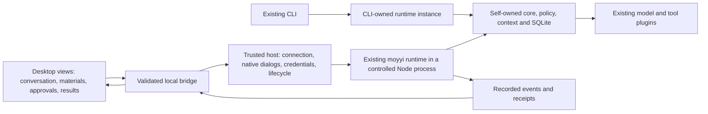

# Roadmap

The [system overview](system-overview.md) owns the dated current state, user-outcome matrix and
next engineering checkpoint. This roadmap separates implementation history from remaining
product acceptance and future scope. A merged phase does not prove that a real model completes
all tasks using its capabilities.

## Implemented foundations

| Delivery | What exists | Contract and historical evidence |
|---|---|---|
| Contracts and eval foundation | Versioned persisted content, ports, plugin registry, task harness, public checkers and negative cases | [Architecture](architecture.md), [corpus](../evals/corpus.md), [historical handoff](tasks/2026-10-24-codex-handoff.md) |
| Read-only loop and CLI | SQLite, core loop, context, policy, file tools, DeepSeek Responses, recording/replay, interactive CLI and development reload | [CLI](cli.md), [DeepSeek](deepseek.md), [batch 7 record](tasks/2026-10-25-batch-7-cli.md) |
| Controlled writes | Confined create/edit, digest-bound approval, snapshots and undo | [Writes](writes.md), [phase 2 record](tasks/2026-10-25-phase-2-writes.md) |
| Native command execution | Explicit process grants, OS confinement, bounded output, interruption and unknown-effect handling | [Shell limitations](shell.md), [D6 / ADR 0013](decisions/0013-native-process-sandbox.md), [phase 3 record](tasks/2026-10-25-phase-3-shell.md) |
| Recovery and longer sessions | Crash recovery, immutable history and explicit bounded compaction | [Long sessions](long-sessions.md), [phase 4 record](tasks/2026-10-25-phase-4-long-sessions.md) |
| Second provider and web | Anthropic adapter, separately granted fetch/search, bounded HTML text | [Anthropic](anthropic.md), [web](web.md), [phase 5 record](tasks/2026-10-25-phase-5-anthropic-web.md) |
| Local installable candidate | Private tarball, installed CLI/PTY/client/type checks | [Installation](installation.md), [phase 6 record](tasks/2026-10-25-phase-6-candidate.md); merged, not officially published |
| Working guidance, Skills and task measurement | Default/project instructions, explicitly selected Skills, runtime task adapter, bounded request closeout | [Instructions](instructions.md), [Skills](skills.md), [runtime evals](runtime-evaluation.md), [PR #24 record](tasks/2026-10-26-request-budget-closeout.md) |

Accepted D1–D6 are preserved in their ADRs. D2's one-time v1 amendment is complete; subsequent
incompatible persisted changes require versioning and migration. OpenBot reuse already includes
selected YAML-validation experience and independently rewritten HTML-extraction lessons; see
[provenance](openbot-provenance.md). It does not import the old cluster/control-plane architecture.

## Current target: a usable personal desktop candidate

**Goal:** on the owner's Apple Silicon Mac, open moyyi without a development terminal, choose
materials and a workspace, ask one personal agent to do work, control its effects, inspect actual
results, and resume safely after restarting. The three workflows below must have independently
checked outcomes from the installed application. This is a local product candidate, not a public
release or a claim of general model reliability.

The owner requested this whole-product plan on2026-10-27. This supersedes GUI's former deferred
priority. The accepted self-owned core, single-agent scope and D1–D6 remain. M1–M3 established the
accepted baseline; on2026-10-28 the owner accepted M4 for local delivery
with the source-answer quality gap explicitly retained. Integration/installation coordinates
are tracked in the system overview. The original planning delivery itself
did not implement a shell or trigger model calls. Current implementation/live evidence remains
in the [system overview](system-overview.md); the Chinese
owner-facing brief is in the existing [delivery record](tasks/2026-10-26-optimization-plan.md).
This roadmap is the implementation sequence, not another task queue alongside those records.

### M5: specified web pages and recorded sources

Selected by the owner on2026-10-28. Build one complete desktop flow on merged M4: authorize
exact HTTPS sites for the current session, approve each request, inspect actual recorded text,
then create/read back and open a separately approved report. Keep web grants ephemeral and
independent of model, file and command grants. Show source URLs, HTTP status, record times and
truncation without claiming automatic fact verification. Reuse the current web transport and
OpenBot-adapted approval/result components. Search services, authenticated browsing and link
crawling remain outside this delivery.

Completion requires focused authority/lifecycle tests, unchanged full checks and CI, actual
external-package verification, native interaction acceptance and the frozen public-source report
task in the [M5 record](tasks/2026-10-28-desktop-m5.md). M4's owner exception does not waive M5
checks or regrade the original source task. See [ADR0043](decisions/0043-desktop-web-sources.md).

M5's bounded acceptance is complete on `dd897834`: full check144/2884, original web eval9/9,
three CI lanes and actual external-package checks passed. One native Flash task used4 requests
with zero retries and produced a fully read-back8808-byte report; six core facts passed independent
review. Its source-panel ID failure is preserved and fixed through zero-call reopening of the same
record. One source-attribution extension remains noted, without a general fact-verification claim.
[PR48](https://github.com/Peerframe/moyyi/pull/48) tracks merge and backed-up daily installation.

### What counts as the product

The first candidate serves one local owner and one agent, with multiple recoverable conversations.
It connects the existing runtime instead of replacing it. A smaller feature list is acceptable;
an incomplete start-to-result workflow is not. Complete these user-visible outcomes:

| User outcome | Completion condition |
|---|---|
| Start and configure | Launch an installed app outside the checkout; configure/select a supported connection without editing executable host files; show selected model and budget. Reopening a session must not fetch a key or call a model. |
| Select workspace and materials | Show the active canonical workspace and read/write/network grants. Select supported files, show readable scope/unsupported formats, and preserve source files. A file selection must not grant its parent directory or unrelated tools. |
| Understand and control work | Show streamed output, actual tool activity, pending approval, cancellation, partial output and errors. Bind approval to the exact effectId/digest; do not invent progress percentages or infer completion from model prose. |
| Receive a checkable result | Open/reveal an actual generated file or inspect a cited answer; distinguish a proposed output from a recorded successful write. Before opening historical output, check that the current file still exists and whether it changed. |
| Return later | List and reopen sessions; preserve partial and unknown effects, show the active workspace/model/grants, and never repeat an action or restore an old approval automatically. |
| Trust the demonstrated scope | Pass the fixed task-specific factual/artifact checks below as well as interaction and authority checks. A GUI pass or successful tool return cannot override a failed answer rubric. |

Daily Flash/Responses/low and existing limits remain the default. Kimi is an explicit alternative;
a recommended complex-task high entry is conditional on its previously agreed quality gate.
No silent fallback, automatic judge, hidden extra request, or automatic retry is introduced.

### Architecture and integration choice

The current `send`/`subscribe` API is a trusted in-process interface, not a validated untrusted IPC
protocol. Build a thin desktop client and a narrow process bridge around it; retain the existing
session/run/effect identities, SQLite and runtime authority. Do not create a second task engine,
parallel approval store, new backend service, or agent SDK dependency.

The two clients reuse the same runtime implementation; this does not introduce a shared daemon.

The recommended shell is **Electron with a React view**, keeping the required Node26 runtime
independent of Electron's embedded Node version. This reuses the team's maintained desktop/UI
experience and narrowly portable OpenBot components. Chromium adds package/memory cost and a
security-update duty; that cost must be measured from the installed candidate, not ignored.
Tauri remains a fallback if measured distribution/resource constraints defeat this route, but it
introduces a Rust/sidecar integration while the same external runtime packaging remains necessary.
A browser-only page is useful for visual development, but does not meet the desktop launch,
credential and file-dialog target by itself. Do not develop multiple shells in parallel.

Planning evidence: OpenBot commit010439bb pins Electron44.3.0/React19.3.0; these are reviewed source
coordinates, not an instruction to install old or unreviewed dependencies. Electron's official
[process model](https://www.electronjs.org/docs/latest/tutorial/process-model) supports the shell/
renderer separation, and its [security guidance](https://www.electronjs.org/docs/latest/tutorial/security)
requires renderer isolation, constrained bridges and untrusted-content handling. Tauri's
[sidecar documentation](https://v2.tauri.app/develop/sidecar/) confirms external binaries still
need explicit packaging. The preferred route is an engineering recommendation, not measured
performance. At the first slice, pin the actual supported release after checking its source,
release/security notes, license and relevant tests, and record that single decision in an ADR.
Do not start another broad framework survey unless a concrete assumption fails.

Suggested new code is confined to `apps/desktop/` (main/preload/renderer/host bridge); its host
imports public `moyyi/runtime` and `moyyi/contracts` exports. Exact package wiring is settled by the
first installed transport probe. Add explicit layer/import checks for these paths: the renderer
cannot import core/store/runtime internals, Node I/O or credentials. Keep `src/core`, existing
plugins and persisted formats intact unless a demonstrated guarantee/port gap requires a scoped
change. Existing stored formats still require migration for incompatible changes.

Critical integration conditions belong in the first usable slice:

- Bundle/resolve an exact supported Node runtime and parser dependencies; prove startup and
  one document extraction/containment packaging canary outside the source checkout. This M1
  compatibility probe is not the seven-format materials/report workflow, which belongs to M2.
  Do not assume Electron embeds the required
  Node/SQLite ABI or silently depend on the owner's developer PATH.
- Keep model credentials in the trusted host/native credential store. Use data-only validated
  settings, never treat a user-facing form or imported JSON as executable host/plugin code.
- Validate bridge messages, sending window/process, size, session/run IDs and active workspace.
  Renderer content cannot invoke arbitrary files, commands, URLs, config code or generic IPC.
  Render model/doc text without executable HTML; grant each external navigation explicitly.
- Preserve a single writer for each store. Wait for runtime close before switching connection,
  data directory or ownership. Initially use exclusive open with a visible conflict refusal when
  CLI or desktop already owns that store; no concurrent-writer coordinator/service is needed.
- Native picker/import/open actions are explicit host actions with bounded scope. Opening a
  result is a user gesture, not a model-authorized shell call. Handle missing/changed outputs.
- Reuse actual events and receipts; keep failed, cancelled, denied, budget-exhausted and unknown
  states distinct. Config/startup failure must not erase prior credentials or conversations.

### Delivery order and observable checkpoints

Each slice is an independent branch/PR from current main, integrated only after review and CI.
Avoid stacked PRs. Keep the installed CLI baseline usable until a newer candidate passes its
installation checks. These are acceptance checkpoints, not estimates or completion percentages.

| Milestone | Deliverable and actual user checkpoint | Dependencies / exit gate |
|---|---|---|
| **M1: installed desktop read-only loop** | Open app → select workspace → use an existing secure Flash connection → send a request → observe real tool/output/error state → cancel or finish → reopen its history. First functional PR starts this path and adapts the OpenBot approval-card presentation where read approvals are needed. | Native startup/bridge/Node26/store ownership proven from an installed bundle; real runtime and temporary files, no product mock backend. Scripted interaction evidence and a separately labelled bounded live read case; denied/stale approval and close/reopen behavior checked. Missing connection has an actionable state. |
| **M2: materials, settings and delivered reports — accepted baseline** | Configure a connection without a terminal; select documents; generate an explicitly approved report; open it from a receipt-backed result card. Accepted and installed through [PR #45](https://github.com/Peerframe/moyyi/pull/45). | Seven existing parsers reused; workspace-local materials only. External import remains separate. Report content was checked against actual source, not only file existence. |
| **M3: edit, inspect, resume and undo — accepted installed baseline** | Preview a change → deny once → approve → check → interrupt/reopen → inspect → undo. External-copy/native gates and one independently authorized live repair/check/two-snapshot reverse undo passed. Final source check131/2644 passed. Installed source6eb2993/main85873c7, [PR #46 receipt](https://github.com/Peerframe/moyyi/pull/46). | First live repair failure remains sealed; the passing repair added a false DOM explanation. Checks retain independent approval, read-only workspace/no network; unknown leases are not automatically released. No M4 acceptance claim. |
| **M4: integrated personal candidate — owner-accepted with a known quality limitation** | Use all three fixed workflows below from the installed app, with normal settings and no developer-assisted file/config repair. Backup/update/rollback and a short user guide accompany the candidate. The [single M4 receipt](tasks/2026-10-28-desktop-m4.md) separates implemented, checked and pending evidence. | M1–M3 interaction/authority, package/native and CI gates remain required. On2026-10-28 the owner explicitly waived the unresolved original-source/public-transfer gate as a blocker to local M4 delivery. Original scores and sealed failures remain; complex-source reliability and Kimi high effectiveness are not accepted or recommended. No public release. |

M1 begins with one real installed transport/runtime feasibility probe, then completes the same
user flow. It is not a separate framework project or a sequence of mock-only prerequisite PRs.
If it cannot preserve runtime compatibility/authority, stop that integration path and compare the
specific alternative before adding more infrastructure. Do not rewrite the core to fit a shell.
M1 implementation follows this sequence; its actual delivery and verification status is recorded
in the system overview. Later milestones remain separate scopes.

### Quality lane: independent progress, explicit final gate

Client work and quality diagnosis can proceed independently where files/decisions do not conflict.
A Kimi outage must not stop file selection, receipts, approval UI or recovery work. Conversely,
GUI completion must not make the original task pass. The owner decision on2026-10-28 permits
local M4 delivery despite the unresolved original task; it changes the delivery gate, not the
rubric or historical verdict. Complex project-analysis correctness remains unverified and must
not be advertised as accepted. New quality trials retain their independent authorization and
original criteria; closed allowances do not reopen.

| Fixed user workflow | Checks that must stay independent |
|---|---|
| **Read a project and explain it with evidence** | Original source1838248, original question/six-item rubric,8 requests/300 seconds/8192 output, zero retry. All six requirements, including selection recreation and indirect-resource limits, must be met without new factual errors. Preserve actual source reads and no-write/no-shell/no-web authority. If a new complex-task configuration passes, then run unchanged source-lifecycle-report and source-dataflow-report with their8-request/120-second limits before recommending it. |
| **Turn documents/data into an actual report** | Use unchanged [`document-comparison-seven-formats` / `document-report-seven-formats`](../evals/documents/tasks.ts) and [fixtures](../src/runtime/fixtures/documents/standard/manifest.json): each4 requests/120 seconds/8192 output, shared8, zero retry. Preserve the [original acceptance](tasks/2026-10-26-optimization-plan.md#文档真实任务验收2026-10-26) factual/artifact checker. Actual output must exist, open, contain correct cited facts/transformations, be re-read and preserve source bytes. This cannot replace source-task correctness; reuse unaffected parser evidence. |
| **Change a file, check it and recover** | Preserve the [PR28 repair/check/two-undo workflow](tasks/2026-10-26-optimization-plan.md#pr28-edit-check-undo-evidence), using the public [listener-leak fixture/checker](../evals/tasks/listener-leak/task.ts): two runs, each8 requests/180 seconds/8192 output, shared12 HTTP, zero retry. Its historical actual8 requests is not the cap; the standalone public task's15-request cap is not this workflow. Denial/stale approval, cancellation/reopen and no-replay desktop checks are incremental interaction/recovery evidence, not behavior already proven by the old live run. Keep source-derived functional checks and byte-exact undo separate from readback. |

Before an affected live run, freeze task/source/config/capabilities, per-task request/time/output
ceilings and the independent checker. Use existing records for unchanged paths; never transfer
unused sealed allowances, inject hidden rubrics, or select the best of repeated runs. Any additional
fresh-material usability example is separately specified before use and cannot replace these
checks. Scripted interactions, actual tool effects and model task quality have separate verdicts.
Report per-task attempts, outcome, missing facts, wrong claims, time and available usage; absent
usage stays unknown. Do not invent a universal pass percentage from a few cases.

Current quality facts: original Flash and Kimi low explanations failed; the notes candidate was
withdrawn; the earlier Kimi high control returned first-request429 engine overload and produced
no answer to score. The new actual-desktop Kimi high trial completed in5 requests/138.996 seconds,
with22 successful read tools and unchanged source. Original-rubric items1/2/3/5 were met and4/6
were partial: runtime recreation after selection changes and no automatic script execution remain
omitted despite reading the relevant implementations. Its strict FAIL is sealed; the two conditional
public tasks were not triggered and each used0 requests. M4 labels high experimental, not a verified
complex-task recommendation; Flash remains low. The current runtime differs from the old isolated
control, so do not claim effort-only causality. Continuous paid-validation authorization does not
waive zero-retry or fixed-budget rules, reopen sealed allowances, or authorize rerolling this answer.

The other M4 checkpoint is local maintenance and daily usability. [ADR 0040](decisions/0040-desktop-local-maintenance.md)
keeps backup/restore/rollback in the trusted local host, outside model tools. Restore only the
session store in place after publishing a rescue backup; preserve settings, Keychain and workspace
files. Roll back only to a verified retained app compatible with current data/settings. Neither
action replays effects or restores old grants. Current explicit high settings are incompatible
with older three-field desktop settings; refuse rollback instead of silently rewriting them.
These paths passed source, external-bundle and actual native backup/restore/rollback checks on
clean source `edc5207`: restore kept a rescue backup, rollback cancelled once and then automatically
reopened the retained M3 app with readable history. Current settings/workspace were unchanged;
maintenance made0 model requests. Evidence is in the [M4 receipt](tasks/2026-10-28-desktop-m4.md).
That isolated maintenance evidence did not itself remove the source-task gate. The owner's later
2026-10-28 delivery exception now permits M4 integration; it does not change the source-task score.
The system overview and installation receipt identify the actual daily version.

### OpenBot reuse within this sequence

The owner requested a plan on2026-10-28 to transfer **all applicable OpenBot capabilities**.
This expands the earlier M1–M5 selection; it does not authorize replacing moyyi's self-owned
core with OpenBot's runtime. This is a planning delivery only: no new capability, provider,
background task or permission is enabled by this document.

The scope is every implemented capability in fixed OpenBot
`010439bb9002fabb7e1facd8450ee85edbafa309` that is useful to one personal local agent, plus a
separate review of relevant uncommitted work once its source is fixed. The
[transfer inventory](openbot-provenance.md#complete-transfer-inventory) owns source paths and
row dispositions. This roadmap owns delivery order; the system overview owns current status.
No parallel migration queue is introduced. Existing M1–M5 adaptations and accepted evidence stay
in place. A feature already served by moyyi is retained and checked for actual gaps, not rebuilt
merely to copy more upstream files.

#### Scope and architectural rules

- Transfer working capabilities, reusable UI, independent utilities and failure cases. Prefer a
  small direct adaptation where contracts fit; otherwise retain the useful behavior/tests and
  implement its local boundary. Every imported file retains its exact source and license. Before each new dependency/protocol/
  permission/storage decision, check primary upstream source/docs/issues, pin the reviewed version
  and record the decision in the existing ADR/research structure; do not import upstream lockfiles.
- Core, context, SQLite store, effect journal, policy and client protocol remain moyyi's. UI calls
  the trusted desktop host; capabilities use existing plugin contracts and runtime-owned ports.
  Parsing, external processes and browser connections stay outside the renderer and core.
- Keep one authority and one execution history. OpenBot Server/HTTP/SQL state is not a second
  source of truth. No Bot/channel/team routing, remote Worker enrollment, PostgreSQL, Temporal,
  legacy task engine, employee ownership transfer or office visualization is introduced.
- Existing native sandbox defaults, Flash + Responses + low, original task rubrics and request,
  file, document and output limits remain; upstream limits do not override them. New provider choices are explicit optional connections, never silent fallbacks.
- Model tools, imported files, Skills, memory and MCP output cannot grant permissions. Reopening
  does not restore execution authority. New side effects have an effect profile, scoped grant,
  approval where required, bounded cancellation and truthful unknown-effect handling.
- New storage for imported assets, skill versions, memory or schedules requires a reviewed schema
  and versioned migration with backup/old-store/rollback compatibility. The consumed v1 exception
  is not reopened; follow the [persisted-format recipe](recipes/change-persisted-format.md).
- User chats, credentials, cookies, browser profiles, memories and permissions are not silently
  copied from OpenBot. Safe templates and explicitly selected assets are separate from private
  data migration. Each upstream bundled asset/skill/dependency needs its own license review.

#### Delivery order and finite acceptance

Every row below must end in a usable installed flow. A milestone can use several small sequential
PRs when necessary; each PR targets the latest merged main. Do not build all backends before
connecting them to the desktop. Reuse unchanged prior checks and do not relabel source review,
fixtures or contract-only support as native or live acceptance.

| Stage | User-visible delivery and reuse | Dependencies / finite completion evidence |
|---|---|---|
| **M6 — Materials, results and complete history** | Import selected external files through picker/drop/paste; keep originals and content hashes, manage references and recoverable removal, with age-based housekeeping disabled unless explicitly enabled. Render safe Markdown tables/lists and bounded PNG/JPEG previews; open/save receipt-backed results. Add complete paged history, name search, pin/group/mute/rename and recoverable session removal. Adapt attachment/message/result views and local saving patterns. | First vertical slice: select an external document, import a bounded snapshot into the chosen workspace, read it with existing parsers, produce/open a report and restore after restart. Source bytes unchanged; collision, cancel, replacement, denied import, referenced-file removal and restore covered. No raw HTML execution, remote image load or path/permission expansion. Delivered preview must be usable in normal/narrow supported windows. |
| **M7 — Personal setup, Skills and safe templates** | Connection management with explicit supported model/API/capability settings; personal role/preferences without multiple Bot identities. A desktop skill library supports import, complete review, version/digest, enable/disable/revoke, discovery and on-demand bounded reads. Safe template export/import carries reviewed reusable instructions with license and digest. | Build on M6 input/preview. Restart and switch connections without implicit key/model changes. One task discovers and reads an enabled skill; disabled/revoked/changed/unreviewed versions cannot be used and allowed-tools grants no authority. Import/export has a readable diff, no credentials/private history/permissions, disabled defaults and explicit local review. Upstream v1 metadata-only and explicit v2 single-file content differ; no arbitrary skill directory/script execution is inferred. |
| **M8 — Images, OCR and voice** | Adapt local image OCR, recording/cancel UI and explicit media-transcription transport; allow transient encrypted-PDF input through a trusted native secret field where support is verified. Add optional compatible image/PDF model input only for an explicitly configured and tested provider. | Uses M6 assets and M7 explicit connections. Real local PNG/JPEG OCR with pinned offline languages; record/cancel and one selected synthetic recording transcribed through an explicitly enabled service. Passwords never enter tool arguments, transcript or logs. Cancel/failure preserves originals and prior valid output; missing language/key/provider is explicit. No upload on selection/view, automatic external fallback, OCR accuracy guarantee, scan-PDF rasterization or legacy Office support inherited from upstream. |
| **M9 — Web research and controlled browser** | Extend existing desktop web settings to a selected search backend; integrate browser observation, navigation, bounded actions and user takeover using the useful OpenBot approval/observation patterns. Keep M5's source records and report path. | Separately verify the configured search backend returns results that map to actual sources. Prove the actual local browser/driver and containment outside the checkout, then finish observe→approved action→result artifact in one disposable public test site. Bind decisions to current observation/session, reject stale approvals, prevent agent input during takeover, and preserve unknown after interruption. Login requires a separate explicit user flow; no copying the owner's normal browser profile. OpenBot's Linux qualification fixture is not a production installer; macOS/native execution must be independently established. |
| **M10 — Reviewed knowledge and memory** | A personal knowledge/notes library and candidate memories with provenance, user accept/edit/reject/disable/delete, scoped retrieval and export choices. Reuse bounded catalog, candidate/review lifecycle and memory views; retain Hermes attribution. | Uses M6 materials/M7 identity-free personal settings. Accept a synthetic preference, reopen, apply it in a different session, then revoke it and prove it is no longer supplied. Keep project/private/global scope separate; stale references and injection cannot change authority. Memory is not a hidden system prompt, a copy of all chats, raw reasoning or a second task store. |
| **M11 — MCP extensions** | Tool/resource/prompt discovery and explicit connections/grants, followed by isolated interactive MCP Apps where actual host support is proven. Adapt useful catalogs, review/approval views and bounded transport behavior. | Tools/resources/prompts ship first through the existing registry/ports. Run a disposable real MCP server through the installed app: discovery, approval, revoke, user-initiated reconnection, cancel and changed descriptor checks. Never automatically replay sent or unknown-result calls. App HTML runs only in an isolated frame with bounded resource reads; preserve denial of upstream-unwired host capabilities. Origin/identity/message rules prevent direct privileged IPC, arbitrary navigation and unapproved tool calls; broader in-frame tool execution is a separate extension. Existing synthetic peers or refusal-only paths are not sufficient success evidence. |
| **M12 — Scheduled work and notifications** | Personal schedules, pause/resume/delete, next/last outcome, non-overlap and notifications opening the actual run. Reuse interval/coalescing/status behavior and desktop notification patterns. | Build on persisted runtime and the earlier capability grants. A real local scheduler creates one run, survives restart, skips overlap, coalesces missed occurrences and respects pause/revoke. It submits through the same protocol/policy; no second agent loop or implied approval. Explicitly show whether the app must stay running; background startup is opt-in. Fixed elapsed intervals are not calendar/DST-aware cron; unknown submissions are reconciled without blind retry. |
| **M13 — Daily integration and transfer closure** | Finish remaining reusable desktop preferences/navigation, original/result saving and content-controlled audit export; qualify maintenance against the new stored assets, Skills, memories and schedules. Reconcile every inventory row and verify combined daily flows. | New store backup/restore/software rollback plus complete existing session compatibility. Independent tasks cover external document→report, Skills+memory→new session, browser/MCP→artifact, and scheduled read→notification; inspect real facts/files/forbidden effects. Every applicable row has installed evidence. An unresolved blocker keeps that row and overall transfer closure incomplete; record it and continue independent rows. M4's original quality gap remains visible and is not waived by migration success. No public release or unsupported-platform claim. |

**M6 is the first implementation checkpoint.** It must deliver one ordinary external-document
workflow before adding the rest of its library/preview refinements. Later stage research should
settle its current dependency/authority decision, not delay that first product improvement.
M8 can proceed once M6/M7 are accepted; M9–M11 share existing ports but each has independent
permissions and acceptance. Scheduling is last because it must reuse already verified foreground
capabilities. M13 is not permission to postpone integration or regressions until the end.

#### What “all transferred” means

For every inventory row, retain the original path/revision, actual upstream behavior, disposition,
moyyi owner, license, focused checks, package/native evidence and remaining limitation. The copied
code table records only actual adaptations, never this plan. “Covered by existing moyyi” requires
behavior evidence; “planned”, “source reviewed”, “unavailable credential”, “declaration only” and
“not tested on this platform” cannot be relabeled completed. No percentage based on file count.

The frozen inventory is grouped by user capabilities and repository ownership, not a claim that
every source line was audited. During each port follow imports/consumers/tests and classify any
newly found reusable module in the same inventory. Before declaring completion, scan all product
roots again and close uncovered rows. Relevant uncommitted upstream changes need a fixed reviewed
revision or content-hash snapshot with provenance before use; they are a visible pending source
set, not silently ignored or automatically committed on the owner's behalf.

There are separate outcomes: **capabilities available**, **task correctness demonstrated**, and
**public release ready**. They must not be combined. The original six-item source task and all
sealed failures keep their scores. Project-context selection and real check feedback may improve
quality, but a map, checklist, another model critique or successful readback is not proof of a
correct answer. Apply a bounded hypothesis to the demonstrated failure layer, keep the original
budget, and stop/research a different route when it fails rather than reroll the same prompt.

Planning does not start implementation, run paid calls or change the installed app. When
implementation starts, apply the existing owner authorization for necessary bounded live validation
and review/CI-gated sequential merge/install within its scope; the planning request itself adds
no new external-service, credential or private-data permissions. Freeze each new task/config/request/time/cost envelope before execution and retain
failed trials; sealed allowances are never reused. Missing external service credentials may block
that capability's real acceptance, while independent stages continue. Public release, new accounts,
user-data uploads and wider personal permissions remain governed by their specific authority.

### Reassessment, reporting and scope control

Use the same diagnostic chain for every failure: **input/settings → evidence acquisition →
context delivery → model interpretation → effect execution → result verification → presentation**.
Locate the first demonstrated break before changing code. Evidence already delivered with a
wrong conclusion is not automatically a retrieval defect; a UI omission is not automatically a
model error; a provider429 is unavailable evidence, not a task-quality score.

For each hypothesis, state the expected observable improvement and freeze one candidate comparison.
If it fails that gate, close it and inspect a different demonstrated layer or maintained public
solution. No repeated small prompt variants, same-question rerolls, renamed checklists, automatic
review framework or more agents to hide lack of progress. New evidence can justify another scoped
change; elapsed work or a large test count cannot. Research must settle a current choice, use
primary source/tests/issues, pin the version and record what was actually copied.

Track one current table in the system overview: milestone, usable installed behavior, demonstrated
limits, acceptance evidence, next checkpoint and blocker. This roadmap owns sequence; the delivery
record owns history. Do not maintain parallel current queues. Each PR reports implementation,
commands/results, unfinished/unverified parts and decisions. Distinguish implemented, installed,
interaction-tested and semantically accepted. Preserve old failures and a rollback package/config/
session backup before any installation. Publish no release/tag/registry package under this plan.

No calendar or percentage estimate is justified until M1's installed-process probe measures the
actual integration cost. That probe must lead directly into the first usable slice, not postpone
visible delivery indefinitely. Re-estimate remaining milestones from demonstrated scope and blockers.

## Directions outside the transfer sequence

The2026-10-28 plan brings existing OpenBot OCR/media, browser/search, Skills, reviewed memory,
MCP and fixed-interval scheduling into M6–M13. They remain **unimplemented** until their own gates
pass; this supersedes their earlier blanket deferral. The following remain outside scope:

- New general visual/scan-PDF understanding, arbitrary skill scripts, autonomous self-learning,
  sub-agents, and computer drivers for which upstream has declarations but no viable execution.
- Remote Bot/team/cluster operation, human-account/employee ownership transfer and a second core.
- Optional Docker backend; native system isolation remains the accepted default.
- Qwen/shasha model training, additional model projects and organization/team/Bot-cluster features.
- Other desktop platforms until their actual bundle/user flows are exercised.
- Public versions, signed/notarized public installers and automatic updates require separate
  release authorization. Local backup/update/rollback is part of M4, not a public launch.

The dated task archive is for reproducing earlier decisions and checks. It is not the current
backlog; old phrases such as “next phase” or “awaiting review” retain their historical meaning.
