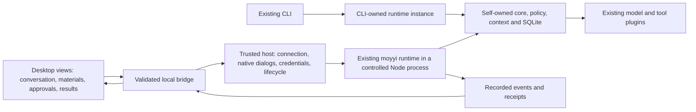

# Roadmap

The [system overview](system-overview.md) owns the dated current state, user-outcome matrix and
next engineering checkpoint. This roadmap separates implementation history from remaining
product acceptance and future scope. A merged phase does not prove that a real model completes
all tasks using its capabilities.

## Implemented foundations

| Delivery | What exists | Contract and historical evidence |
|---|---|---|
| Contracts and eval foundation | Versioned persisted content, ports, plugin registry, task harness, public checkers and negative cases | [Architecture](architecture.md), [corpus](../evals/corpus.md), [historical handoff](tasks/2026-10-24-codex-handoff.md) |
| Read-only loop and CLI | SQLite, core loop, context, policy, file tools, DeepSeek Responses, recording/replay, interactive CLI and development reload | [CLI](cli.md), [DeepSeek](deepseek.md), [batch 7 record](tasks/2026-10-25-batch-7-cli.md) |
| Controlled writes | Confined create/edit, digest-bound approval, snapshots and undo | [Writes](writes.md), [phase 2 record](tasks/2026-10-25-phase-2-writes.md) |
| Native command execution | Explicit process grants, OS confinement, bounded output, interruption and unknown-effect handling | [Shell limitations](shell.md), [D6 / ADR 0013](decisions/0013-native-process-sandbox.md), [phase 3 record](tasks/2026-10-25-phase-3-shell.md) |
| Recovery and longer sessions | Crash recovery, immutable history and explicit bounded compaction | [Long sessions](long-sessions.md), [phase 4 record](tasks/2026-10-25-phase-4-long-sessions.md) |
| Second provider and web | Anthropic adapter, separately granted fetch/search, bounded HTML text | [Anthropic](anthropic.md), [web](web.md), [phase 5 record](tasks/2026-10-25-phase-5-anthropic-web.md) |
| Local installable candidate | Private tarball, installed CLI/PTY/client/type checks | [Installation](installation.md), [phase 6 record](tasks/2026-10-25-phase-6-candidate.md); merged, not officially published |
| Working guidance, Skills and task measurement | Default/project instructions, explicitly selected Skills, runtime task adapter, bounded request closeout | [Instructions](instructions.md), [Skills](skills.md), [runtime evals](runtime-evaluation.md), [PR #24 record](tasks/2026-10-26-request-budget-closeout.md) |

Accepted D1–D6 are preserved in their ADRs. D2's one-time v1 amendment is complete; subsequent
incompatible persisted changes require versioning and migration. OpenBot reuse already includes
selected YAML-validation experience and independently rewritten HTML-extraction lessons; see
[provenance](openbot-provenance.md). It does not import the old cluster/control-plane architecture.

## Current target: a usable personal desktop candidate

**Goal:** on the owner's Apple Silicon Mac, open moyyi without a development terminal, choose
materials and a workspace, ask one personal agent to do work, control its effects, inspect actual
results, and resume safely after restarting. The three workflows below must have independently
checked outcomes from the installed application. This is a local product candidate, not a public
release or a claim of general model reliability.

The owner requested this whole-product plan on2026-10-27. This supersedes GUI's former deferred
priority. The accepted self-owned core, single-agent scope and D1–D6 remain. The planning delivery
does not implement a desktop shell, change the daily model or trigger model calls. Current
implementation/live evidence remains in the [system overview](system-overview.md); the Chinese
owner-facing brief is in the existing [delivery record](tasks/2026-10-26-optimization-plan.md).
This roadmap is the implementation sequence, not another task queue alongside those records.

### What counts as the product

The first candidate serves one local owner and one agent, with multiple recoverable conversations.
It connects the existing runtime instead of replacing it. A smaller feature list is acceptable;
an incomplete start-to-result workflow is not. Complete these user-visible outcomes:

| User outcome | Completion condition |
|---|---|
| Start and configure | Launch an installed app outside the checkout; configure/select a supported connection without editing executable host files; show selected model and budget. Reopening a session must not fetch a key or call a model. |
| Select workspace and materials | Show the active canonical workspace and read/write/network grants. Select supported files, show readable scope/unsupported formats, and preserve source files. A file selection must not grant its parent directory or unrelated tools. |
| Understand and control work | Show streamed output, actual tool activity, pending approval, cancellation, partial output and errors. Bind approval to the exact effectId/digest; do not invent progress percentages or infer completion from model prose. |
| Receive a checkable result | Open/reveal an actual generated file or inspect a cited answer; distinguish a proposed output from a recorded successful write. Before opening historical output, check that the current file still exists and whether it changed. |
| Return later | List and reopen sessions; preserve partial and unknown effects, show the active workspace/model/grants, and never repeat an action or restore an old approval automatically. |
| Trust the demonstrated scope | Pass the fixed task-specific factual/artifact checks below as well as interaction and authority checks. A GUI pass or successful tool return cannot override a failed answer rubric. |

Daily Flash/Responses/low and existing limits remain the default. Kimi is an explicit alternative;
a recommended complex-task high entry is conditional on its previously agreed quality gate.
No silent fallback, automatic judge, hidden extra request, or automatic retry is introduced.

### Architecture and integration choice

The current `send`/`subscribe` API is a trusted in-process interface, not a validated untrusted IPC
protocol. Build a thin desktop client and a narrow process bridge around it; retain the existing
session/run/effect identities, SQLite and runtime authority. Do not create a second task engine,
parallel approval store, new backend service, or agent SDK dependency.

The two clients reuse the same runtime implementation; this does not introduce a shared daemon.

The recommended shell is **Electron with a React view**, keeping the required Node26 runtime
independent of Electron's embedded Node version. This reuses the team's maintained desktop/UI
experience and narrowly portable OpenBot components. Chromium adds package/memory cost and a
security-update duty; that cost must be measured from the installed candidate, not ignored.
Tauri remains a fallback if measured distribution/resource constraints defeat this route, but it
introduces a Rust/sidecar integration while the same external runtime packaging remains necessary.
A browser-only page is useful for visual development, but does not meet the desktop launch,
credential and file-dialog target by itself. Do not develop multiple shells in parallel.

Planning evidence: OpenBot commit010439bb pins Electron44.3.0/React19.3.0; these are reviewed source
coordinates, not an instruction to install old or unreviewed dependencies. Electron's official
[process model](https://www.electronjs.org/docs/latest/tutorial/process-model) supports the shell/
renderer separation, and its [security guidance](https://www.electronjs.org/docs/latest/tutorial/security)
requires renderer isolation, constrained bridges and untrusted-content handling. Tauri's
[sidecar documentation](https://v2.tauri.app/develop/sidecar/) confirms external binaries still
need explicit packaging. The preferred route is an engineering recommendation, not measured
performance. At the first slice, pin the actual supported release after checking its source,
release/security notes, license and relevant tests, and record that single decision in an ADR.
Do not start another broad framework survey unless a concrete assumption fails.

Suggested new code is confined to `apps/desktop/` (main/preload/renderer/host bridge); its host
imports public `moyyi/runtime` and `moyyi/contracts` exports. Exact package wiring is settled by the
first installed transport probe. Add explicit layer/import checks for these paths: the renderer
cannot import core/store/runtime internals, Node I/O or credentials. Keep `src/core`, existing
plugins and persisted formats intact unless a demonstrated guarantee/port gap requires a scoped
change. Existing stored formats still require migration for incompatible changes.

Critical integration conditions belong in the first usable slice:

- Bundle/resolve an exact supported Node runtime and parser dependencies; prove startup and
  one document extraction/containment packaging canary outside the source checkout. This M1
  compatibility probe is not the seven-format materials/report workflow, which belongs to M2.
  Do not assume Electron embeds the required
  Node/SQLite ABI or silently depend on the owner's developer PATH.
- Keep model credentials in the trusted host/native credential store. Use data-only validated
  settings, never treat a user-facing form or imported JSON as executable host/plugin code.
- Validate bridge messages, sending window/process, size, session/run IDs and active workspace.
  Renderer content cannot invoke arbitrary files, commands, URLs, config code or generic IPC.
  Render model/doc text without executable HTML; grant each external navigation explicitly.
- Preserve a single writer for each store. Wait for runtime close before switching connection,
  data directory or ownership. Initially use exclusive open with a visible conflict refusal when
  CLI or desktop already owns that store; no concurrent-writer coordinator/service is needed.
- Native picker/import/open actions are explicit host actions with bounded scope. Opening a
  result is a user gesture, not a model-authorized shell call. Handle missing/changed outputs.
- Reuse actual events and receipts; keep failed, cancelled, denied, budget-exhausted and unknown
  states distinct. Config/startup failure must not erase prior credentials or conversations.

### Delivery order and observable checkpoints

Each slice is an independent branch/PR from current main, integrated only after review and CI.
Avoid stacked PRs. Keep the installed CLI baseline usable until a newer candidate passes its
installation checks. These are acceptance checkpoints, not estimates or completion percentages.

| Milestone | Deliverable and actual user checkpoint | Dependencies / exit gate |
|---|---|---|
| **M1: installed desktop read-only loop** | Open app → select workspace → use an existing secure Flash connection → send a request → observe real tool/output/error state → cancel or finish → reopen its history. First functional PR starts this path and adapts the OpenBot approval-card presentation where read approvals are needed. | Native startup/bridge/Node26/store ownership proven from an installed bundle; real runtime and temporary files, no product mock backend. Scripted interaction evidence and a separately labelled bounded live read case; denied/stale approval and close/reopen behavior checked. Missing connection has an actionable state. |
| **M2: materials, settings and delivered reports** | Configure a connection without a terminal; select documents; generate an explicitly approved report; open it from a receipt-backed result card. Retain clear source/coverage/truncation information. | M1; seven existing parsers reused. Start with workspace-local materials; external files require a separately explicit, bounded copy/import into the chosen workspace with collision/cancel handling, leaving the original untouched. Report content checked against actual source, not only file existence. |
| **M3: edit, inspect, resume and undo** | Preview a change → deny once → approve the intended change → run the supported check → interrupt/reopen → inspect actual outcomes → undo. | M1/M2; reuse current snapshot, policy, process isolation and recovery. Denial/stale approval changes nothing; restore original bytes/mode; no action replay after restart. Shell remains separately authorized and its read-only-workspace limitation stays visible. |
| **M4: integrated personal candidate** | Use all three fixed workflows below from the installed app, with normal settings and no developer-assisted file/config repair. Backup/update/rollback and a short user guide accompany the candidate. | M1–M3 interaction/authority gates plus all applicable semantic gates. No unresolved blocker for the advertised workflow, no hidden failed criterion. General reliability and additional platforms remain unclaimed. |

M1 begins with one real installed transport/runtime feasibility probe, then completes the same
user flow. It is not a separate framework project or a sequence of mock-only prerequisite PRs.
If it cannot preserve runtime compatibility/authority, stop that integration path and compare the
specific alternative before adding more infrastructure. Do not rewrite the core to fit a shell.
When implementation begins, start with M1; this planning turn changes documents
only and makes no paid calls or public release.

### Quality lane: independent progress, explicit final gate

Client work and quality diagnosis can proceed independently where files/decisions do not conflict.
A Kimi outage must not stop file selection, receipts, approval UI or recovery work. Conversely,
GUI completion must not make the original task pass. The full M4 target remains unfinished while
an advertised complex project-analysis workflow fails its original criteria.

| Fixed user workflow | Checks that must stay independent |
|---|---|
| **Read a project and explain it with evidence** | Original source1838248, original question/six-item rubric,8 requests/300 seconds/8192 output, zero retry. All six requirements, including selection recreation and indirect-resource limits, must be met without new factual errors. Preserve actual source reads and no-write/no-shell/no-web authority. If a new complex-task configuration passes, then run unchanged source-lifecycle-report and source-dataflow-report with their8-request/120-second limits before recommending it. |
| **Turn documents/data into an actual report** | Use unchanged [`document-comparison-seven-formats` / `document-report-seven-formats`](../evals/documents/tasks.ts) and [fixtures](../src/runtime/fixtures/documents/standard/manifest.json): each4 requests/120 seconds/8192 output, shared8, zero retry. Preserve the [original acceptance](tasks/2026-10-26-optimization-plan.md#文档真实任务验收2026-10-26) factual/artifact checker. Actual output must exist, open, contain correct cited facts/transformations, be re-read and preserve source bytes. This cannot replace source-task correctness; reuse unaffected parser evidence. |
| **Change a file, check it and recover** | Preserve the [PR28 repair/check/two-undo workflow](tasks/2026-10-26-optimization-plan.md#pr28-edit-check-undo-evidence), using the public [listener-leak fixture/checker](../evals/tasks/listener-leak/task.ts): two runs, each8 requests/180 seconds/8192 output, shared12 HTTP, zero retry. Its historical actual8 requests is not the cap; the standalone public task's15-request cap is not this workflow. Denial/stale approval, cancellation/reopen and no-replay desktop checks are incremental interaction/recovery evidence, not behavior already proven by the old live run. Keep source-derived functional checks and byte-exact undo separate from readback. |

Before an affected live run, freeze task/source/config/capabilities, per-task request/time/output
ceilings and the independent checker. Use existing records for unchanged paths; never transfer
unused sealed allowances, inject hidden rubrics, or select the best of repeated runs. Any additional
fresh-material usability example is separately specified before use and cannot replace these
checks. Scripted interactions, actual tool effects and model task quality have separate verdicts.
Report per-task attempts, outcome, missing facts, wrong claims, time and available usage; absent
usage stays unknown. Do not invent a universal pass percentage from a few cases.

Current quality facts: original Flash and Kimi low explanations failed; the notes candidate was
withdrawn; Kimi high returned first-request429 engine overload and produced no answer to score.
No optional high entry is implemented or recommended as verified. Keep these records sealed.
A later service-available high comparison needs its own bounded record; do not retry it silently.
Existing continuous paid-validation authorization does not waive zero-retry or fixed-budget rules.

### OpenBot reuse within this sequence

Use only fixed committed source, not the current dirty OpenBot checkout. The inspected revision
is010439bb9002fabb7e1facd8450ee85edbafa309 (MIT). Existing document parsing reuse is already integrated;
next reuse concerns presentation and interaction. Candidate inventory and precise paths live in
[provenance](openbot-provenance.md#planned-desktop-reuse-not-yet-ported). No source is copied by this plan.

- M1: adapt the approval-card view and duplicate-click/pending feedback to moyyi events and exact
  effect/digest callbacks. Keep authorization in moyyi; no Bot/channel/domain DTO imports.
- M2: adapt result-card presentation to actual execution receipts and local file-open actions;
  rewrite attachment selection and model settings against local host ports.
- M3: reuse history/late-response interaction lessons, implemented over moyyi session commands.
  Do not port OpenBot's server-login recovery as task recovery or introduce its Work polling model.

Record actual copied/adapted files, upstream commit, MIT notice and new tests at port time. Prefer
small components over copying the whole workspace. Do not import Server identity/authority,
Bot/channel/team concepts, PostgreSQL, Temporal or cluster orchestration. A UI component must fit
moyyi's product contract; its old API must not determine the new architecture.

### Reassessment, reporting and scope control

Use the same diagnostic chain for every failure: **input/settings → evidence acquisition →
context delivery → model interpretation → effect execution → result verification → presentation**.
Locate the first demonstrated break before changing code. Evidence already delivered with a
wrong conclusion is not automatically a retrieval defect; a UI omission is not automatically a
model error; a provider429 is unavailable evidence, not a task-quality score.

For each hypothesis, state the expected observable improvement and freeze one candidate comparison.
If it fails that gate, close it and inspect a different demonstrated layer or maintained public
solution. No repeated small prompt variants, same-question rerolls, renamed checklists, automatic
review framework or more agents to hide lack of progress. New evidence can justify another scoped
change; elapsed work or a large test count cannot. Research must settle a current choice, use
primary source/tests/issues, pin the version and record what was actually copied.

Track one current table in the system overview: milestone, usable installed behavior, demonstrated
limits, acceptance evidence, next checkpoint and blocker. This roadmap owns sequence; the delivery
record owns history. Do not maintain parallel current queues. Each PR reports implementation,
commands/results, unfinished/unverified parts and decisions. Distinguish implemented, installed,
interaction-tested and semantically accepted. Preserve old failures and a rollback package/config/
session backup before any installation. Publish no release/tag/registry package under this plan.

No calendar or percentage estimate is justified until M1's installed-process probe measures the
actual integration cost. That probe must lead directly into the first usable slice, not postpone
visible delivery indefinitely. Re-estimate remaining milestones from demonstrated scope and blockers.

## Deferred directions

- OCR/visual document understanding, browser automation and unverified external search/providers.
- MCP, long-term memory/learning, sub-agents and unattended scheduling, each with independent
  authority, lifecycle and task-quality evidence before expansion.
- Optional Docker backend; native system isolation remains the accepted default.
- Qwen/shasha model training, additional model projects and organization/team/Bot-cluster features.
- Other desktop platforms until their actual bundle/user flows are exercised.
- Public versions, signed/notarized public installers and automatic updates require separate
  release authorization. Local backup/update/rollback is part of M4, not a public launch.

The dated task archive is for reproducing earlier decisions and checks. It is not the current
backlog; old phrases such as “next phase” or “awaiting review” retain their historical meaning.
