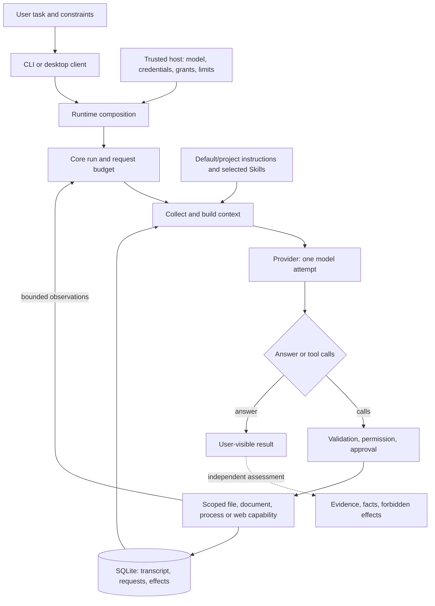

# System overview

Current product, what users can do, and where delivery stands. Rewritten on **2026-10-29**; the
previous text is kept unchanged in the [archive](tasks/2026-10-29-system-overview-archive.md).
[Architecture](architecture.md) owns layer boundaries, [ADRs](decisions/) own decisions,
[roadmap](roadmap.md) owns delivery order, and the [delivery record](tasks/2026-10-26-optimization-plan.md)
and dated receipts in `tasks/` own exact runs and history.

## Product and authority

moyyi is a personal general-purpose agent with a self-owned core. It should complete useful tasks
correctly, within the user's authority, with recoverable state and understandable results. A
working loop, normal completion or a large passing test suite does not prove factual correctness.

- **References**: DeepSeek Harness is the first reference for new capabilities and model
  experience; OpenBot supplies adapted UI pieces, document parsing and failure cases. Neither is a
  dependency; [provenance](openbot-provenance.md) records every reuse.
- **Owner authorization**: ongoing development, necessary paid validation, and sequential merge
  and installation after review and passing CI. No public release.
- **Defaults**: DeepSeek Flash, Responses API, low reasoning, zero retries; daily grants read-only
  until enabled per session. Original tasks and acceptance standards do not change.

## Installed version

| Item | Current |
|---|---|
| Desktop app | M6, verified package source `e0c26bd7`, ZIP SHA-256 `ebc157f9…6441`; merged at `8dd5343` ([PR #50](https://github.com/Peerframe/moyyi/pull/50)); macOS arm64 only |
| CLI | Installed from the same verified tarball; shares the session store with the desktop |
| Session store | Schema 3. M5 and the older PR #41 CLI cannot open it; rollback requires the paired pre-upgrade backup kept with the old programs |
| Daily settings | Flash, low, 3 requests, 120 s, zero retries; optional Kimi `kimi-k3.1-pro` connection |
| Public version | None |

The local installation manifests (`~/.moyyi/desktop-installation.json` and the CLI manifest)
identify the installed artifacts and backups.

## What the user can do

Demonstrated behavior, not a reliability rate. Each row links to the guide that owns its
commands and limits.

| User outcome | Evidence | Limits |
|---|---|---|
| Open the app, find and resume work | [Desktop](desktop.md): installed M6; native launch, history paging, organization, recycle/restore and restart passed | macOS arm64; one SQLite writer; reopened sessions start read-only |
| Read files and explain a project | Guarded search, ranged numbered reads, navigation; original public report task passed | The original complex source explanation still fails its rubric |
| Read PDF, DOCX, XLSX, PPTX, ODT, ODS, ODP | [Native parser](documents.md); two fixed document tasks passed through the desktop | Body text only; no OCR, legacy or macro files, formulas or layout |
| Import materials and inspect results | M6: external PDF/DOCX import, report with full readback, Markdown table and PNG preview, save a copy; one 4-request Flash task met all six criteria | Office/PDF preview is identity only; images are not sent to the model; no original export or quoted reply |
| Modify, check and undo | M3: live repair, check and two-snapshot reverse undo passed against the unchanged checker | First live repair group failed; the passing answer added an incorrect claim |
| Continue longer work | [Long sessions](long-sessions.md): eight turns across reopen and summary kept all ten checked facts | One bounded case |
| Read websites | M5: per-site and per-request approval, recorded sources, report readback; CLI [web](web.md) revision task passed | First report and revision attempts failed; no search service; no autonomous correction shown |
| Transform data and documents | Quoted CSV, format-preserving homework edit and roster merge passed | The model checked bytes and counts, not an independent recomputation |
| Apply guidance and Skills | [Root instructions](instructions.md) and explicitly selected [Skills](skills.md) | Loading guidance does not guarantee following it; nested instructions are not auto-loaded |
| Back up, restore, roll back | M4 [maintenance](desktop.md#backup-restore-and-software-rollback-m4-candidate): native backup, rescue restore and software rollback passed | Rollback across the schema 3 upgrade needs the paired backup |

## Answer quality

The largest open problem. The original six-item source-analysis task is still a strict FAIL: the
best answers (Flash with 8 requests; Kimi high with 5 requests) meet items 1, 2, 3 and 5 and only
partly meet 4 and 6. The required evidence reached the model; the answers omitted two required
conclusions. The latest Flash attempt returned HTTP 429 with no answer and counts as unavailable.

Next step: [delivery one](tasks/2026-10-29-delivery-1-dsh-model-experience.md) aligns moyyi's
model experience with DeepSeek Harness (todo list, repeat reminders, output spill, prompt
assembly), measured by the frozen [quality gate](tasks/2026-10-28-post-m6-plan.md#5-质量门) and one
run of the original task with its frozen budget.

| Closed route | What it showed | Do not |
|---|---|---|
| More retrieval, notes or isolated review | Evidence already arrived; omissions are interpretation, not delivery | Widen retrieval or grants to fix it |
| Same question with more requests or another effort level | No stable gain; Kimi high also failed | Rerun the same question until it passes |
| Pi harness control | Ran once without a complete answer; differences prevent a causal ranking | Treat Pi as a dependency |
| Readback as verification | A model can read back its own wrong report | Count readback as independent validation |
| Fixed runtime defects (ADR [0026](decisions/0026-readable-evidence-and-action-budget.md), [0033](decisions/0033-confirmed-missing-read-diagnostics.md), [0034](decisions/0034-incomplete-response-outcomes.md)) | Real defects, fixed with evidence | Reopen them without a new failure |

## One task through the system

Instructions and source text inform the model; they never grant authority. A model's claim or a
successful tool return does not certify the task is correct.

## Locate the owner before fixing

| Concern | Start in | First evidence |
|---|---|---|
| Launch, configuration, version | [CLI](../src/cli/program.ts), [runtime](../src/runtime/index.ts), `apps/desktop` | [Installation](installation.md), installation manifests |
| Wrong or unhelpful tool output | [fs plugin](../src/plugins/fs/index.ts), [files](../src/runtime/files.ts) | [File contract](files.md), `eval:files` |
| Evidence missing from the request | [Context](../src/context/index.ts), [core loop](../src/core/index.ts) | Request records, `eval:instructions` |
| Evidence arrived, answer wrong | [Provider](../src/plugins/provider-deepseek/), prompts and tool descriptions | Fixed-source answer vs required facts; [runtime evaluation](runtime-evaluation.md) |
| Wrong execution or authority | [Executor](../src/core/executor.ts), [policy](../src/policy/index.ts) | Effect and policy tests, [threat model](threat-model.md) |
| Lost state, repeats, interruption | [Core](../src/core/index.ts), [store](../src/store/) | [Recovery tests](../tests/core-recovery.test.ts), `eval:long-sessions` |
| Misleading success | [Runner](../evals/harness/runner.ts), [eval agent](../evals/agents/moyyi.ts) | [Corpus](../evals/corpus.md) |

## Delivery status

Plan: [post-M6 plan v2](tasks/2026-10-28-post-m6-plan.md). Order is owned by the
[roadmap](roadmap.md).

| Delivery | Status | Receipt |
|---|---|---|
| M1 desktop read and approval loop | Accepted, installed | [PR #44](https://github.com/Peerframe/moyyi/pull/44) |
| M2 settings, materials, reports | Accepted, installed | [PR #45](https://github.com/Peerframe/moyyi/pull/45) |
| M3 editing, checks, undo | Accepted, installed | [PR #46](https://github.com/Peerframe/moyyi/pull/46) |
| M4 maintenance and combined acceptance | Owner-accepted with the known quality gap | [PR #47](https://github.com/Peerframe/moyyi/pull/47), [receipt](tasks/2026-10-28-desktop-m4.md) |
| M5 web pages and recorded sources | Accepted, installed | [PR #48](https://github.com/Peerframe/moyyi/pull/48), [receipt](tasks/2026-10-28-desktop-m5.md) |
| M6 materials, previews, history | Accepted, installed daily | [PR #50](https://github.com/Peerframe/moyyi/pull/50), [receipt](tasks/2026-10-28-desktop-m6.md) |
| Delivery zero: agent environment | In review | [PR #51](https://github.com/Peerframe/moyyi/pull/51), [brief](tasks/2026-10-29-delivery-0-vibe-coding-env.md) |
| Delivery one: model experience aligned with DSH | Ready for Codex | [Brief](tasks/2026-10-29-delivery-1-dsh-model-experience.md) |
| Delivery two: desktop feature modules | Implemented; source, package and native checks passed; awaiting review | [Brief](tasks/2026-10-29-delivery-2-desktop-modules.md), [record](tasks/2026-10-29-desktop-modules-delivery.md) |
| Delivery three: settings, Skills, search | Planned after one and two | [Plan](tasks/2026-10-28-post-m6-plan.md) |
| Delivery four: conditional capabilities | Triggered per item | [Plan](tasks/2026-10-28-post-m6-plan.md) |

## Boundaries

- Keep original standards, versioned persistent data, default read-only authority and existing
  request and output limits. Public publication needs separate authorization.
- Before a substantial change, name the user outcome, the path through the diagram, the observed
  failure and a finite exit condition.
- Update this page and the delivery record together. Dated runs and narratives go to `tasks/`;
  this page stays current and short.
