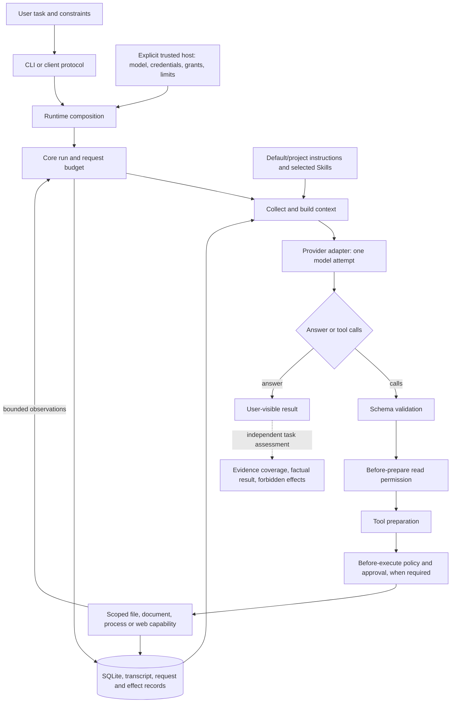

# System overview and current engineering direction

This is the starting point for reasoning about moyyi as a product. It connects user outcomes,
implementation owners, evidence and the next delivery. It is not another layer specification:
[architecture](architecture.md) owns boundaries, [ADRs](decisions/) own decisions,
[roadmap](roadmap.md) owns future scope, and dated [task records](tasks/) preserve historical results.

## Product goal and current checkpoint

moyyi is a new personal, general-purpose agent with a self-owned core. Success means completing
useful tasks correctly, within the user's authority, with recoverable state and understandable
results. A working loop or a large passing test suite is necessary but does not establish that
success. OpenBot contributes selected technology and failure experience through moyyi's own
contracts; it does not supply a bot-cluster architecture. Model training, including shasha/Qwen,
is deferred. Accepted D1–D6 remain in force.

**Current checkpoint: verified daily workflows.** Seven-format document reading is merged and
both fixed live document tasks passed. The owner has authorized necessary paid validation and
sequential review/CI/merge/install for this continuing product goal; official publication remains
separate. Installed live trials now cover controlled edit/check/undo, long-session fidelity and real
web reading. The next bounded outcome is an explicit everyday CLI entry for these grants. The fresh original 4+4 regression now passes public report delivery; the complex Skills
explanation still fails its original rubric and is not relabeled as solved. A real eight-turn
conversation, process reopen, compaction and further reopen preserved all ten checked facts and
constraints. OCR, demand-driven MCP/GUI/memory and model training stay deferred.

## Version and evidence coordinates

Audited on **2026-10-26**. These are evidence snapshots, not moving branch guarantees; check Git
and the referenced PR before changing code. No current authorization is inferred from old records.

| Coordinate | Audited state | What it means |
|---|---|---|
| Merged product baseline | `b6e952c8f6eb0bed2ad21bd76d707488ce089b81`, through [PR #27](https://github.com/Peerframe/moyyi/pull/27) | Independent review found no blocker; fixed-head CI and [merged main CI](https://github.com/Peerframe/moyyi/actions/runs/40341366800) passed. Includes seven-format document reading and prior navigation. |
| Current candidate | [PR #28](https://github.com/Peerframe/moyyi/pull/28), product `487ccfb4f434952a63a890582dec3651e0751e0d` | Explicit Cloudflare DoH and precise macOS toolchain-alias metadata. [Original Linux/macOS CI](https://github.com/Peerframe/moyyi/actions/runs/40344895500), clean package and actual installation passed; live scope is below. |
| Current local installation | Product `487ccfb`; tar SHA256 `8d8864f0a316cddbcb327f1505451c24ff3b3385b3c94ffd5b1b745d661c07db` | 360 files match the clean accepted package. CLI/client/PTY, seven-format documents/report/readback, isolation and dependency graph passed; existing-session resume/help/exit passed. Backup and previous package retained. Flash + Responses + low, daily read-only/max3/zero-retry host unchanged. |
| Prior installed baseline | Product `69312969533659578cc1da21b510d8395a099ef3`; tar SHA256 `12b2aee9c116e432ab23780c32c793adc094708995dc7d7f393a1ac1fe3774a5` | 244-file identity and CLI/client/PTY/offline navigation evidence remain valid for this prior package. The document upgrade has its own acceptance receipt and backup in the [optimization plan](tasks/2026-10-26-optimization-plan.md). Flash + Responses + low, daily read-only/max3/zero-retry settings are retained. |
| Document live acceptance | Installed `e64fa0e`; 2026-10-26, Flash + Responses + low | Both fixed tasks passed their unchanged checkers once: actual comparison/report files, seven facts/hashes/quotes, approved total CNY 5,500, readback and unchanged inputs. Eight HTTP 200 requests, zero retries; each attempted shell once and was denied before using controlled create/read. [Evidence and limits](tasks/2026-10-26-optimization-plan.md#文档真实任务验收2026-10-26). |
| Latest autonomous investigations | Installed `e64fa0e`, 2026-10-26, fresh original4+public4 baseline | Eight HTTP200 requests, zero retries, unchanged snapshots/prompts/rubric/checker. Public source-dataflow report exists and its official checker passes. Original Skills explanation still makes a raw-text/parsed-field error and omits consumers/lifecycle. No corpus reliability claim. |
| Real long-session acceptance | Installed `e64fa0e`, separate processes | Eight live conversation turns, one summary, one follow-up; all ten corrected facts/constraints/pending-state fields correct after reopen. Resume makes no request; original transcript retained; early facts are inside the summarized span. One case, not a universal fidelity claim. |
| Real edit/check/undo acceptance | Installed `487ccfb`, native sandbox | Public listener-leak fixture repaired and checked, then both snapshots undone in reverse order. Original bytes/mode and original failure restored; checker and outside canary unchanged. Eight HTTP200 requests, zero retries. |
| Real web report acceptance | Installed `487ccfb`, explicit DoH | Actual full RFC8259 fetched, report created and read back in four requests; required five facts correct. Two incidental unsupported claims needed human review and a separate four-request revision. Revised bytes independently checked; the model omitted revision readback, so that later workflow is not marked fully passed. |
| Public release | None | Local candidate installation is not npm/GitHub publication or a release tag. |

The merged public corpus has 32 tasks. Two new fixed document tasks are prepared as a separate
acceptance group; they do not change the original task selection or rubrics. Reference/checker tests and scripted
conformance are not real-model corpus results. No same-model, same-budget comparison with a mature
harness has been executed. Earlier full-source and model/effort diagnostics are recorded in
[PR #25's fixed evidence record](https://github.com/Peerframe/moyyi/blob/650a00b06bcabc308d9cebeffc0e037658eb6457/docs/decisions/0022-evidence-guidance-and-focused-reads.md)
and [reasoning record](https://github.com/Peerframe/moyyi/blob/650a00b06bcabc308d9cebeffc0e037658eb6457/docs/tasks/2026-10-26-configurable-reasoning.md).
Do not repeat those experiments merely because a new contributor has not read them.

## One task through the whole system

The assessment box is an engineering activity, not a hidden production truth checker. A model
claim, plan status or successful tool return cannot certify that the user's task is correct.
Instructions and source text can inform the model; they cannot grant tool authority. Persistence,
recovery and cancellation apply throughout the loop, not only after an answer.

## What can a user do, and what is actually verified?

| User outcome | Entry and dependencies | Available evidence | Remaining limit |
|---|---|---|---|
| Start, resume and use a local agent | [CLI](cli.md), explicit host, Node/toolchain, credentials for live use | [Installed CLI/PTY/client acceptance](installation.md); a bounded DeepSeek file/tool continuation passed after #19 | Setup still requires trusted host configuration. A successful connection is not task competence. |
| Inspect a project and explain its behavior | File tools, instructions, context, provider and final answer | Real tool continuation and bounded final closeout; candidate source windows, exact scopes, filters and discovery outputs are verified against actual files; opt-in path context and scripted read/create/verify delivery now have offline evidence | The latest live follow-up passes public report delivery but still fails the original Skills explanation criteria. Native tool-text transport is accepted; one trial per task is not a reliability baseline. |
| Change files, inspect changes and undo | [Write grant, approvals, snapshots](writes.md); shell grant if checks need a process | Filesystem/SQLite safety checks plus one real repair/check/undo task with exact content/mode restoration | One task is not an edit reliability rate; daily host remains read-only and enabling the grants still requires explicit configuration. |
| Run commands and stop them | [Shell plugin](shell.md), explicit process grants, supported native sandbox/toolchain | Native-process conformance and documented platform tests | macOS detached descendants/host hard-kill limitations remain. Docker is a planned optional adapter, not an implemented fallback. |
| Continue long work without losing state | [Store and long sessions](long-sessions.md), resume, explicit compaction | Crash/recovery and scripted lifecycle tests; a live eight-turn/reopen/compact/reopen case preserved ten facts and constraints | One semantic case does not establish long-task reliability or cache savings. |
| Apply project guidance and reusable Skills | [Instructions](instructions.md), [Skills](skills.md), trusted selection and read grants | Refresh, selection, bounds and authority conformance; [OpenBot reuse](openbot-provenance.md) already includes YAML-validation experience | Guidance quality is not guaranteed by correct loading; automatic nested instruction discovery is not implemented. |
| Read supported documents and produce checkable results | [Documents](documents.md), workspace read grant and native parser sandbox | Complete application-generated files, scripted next-context/report/readback checks and independently installed package isolation passed on macOS and Linux; actual owner installation rechecked | Two fixed live tasks passed once; this is not a reliability rate or large-document benchmark. OCR, legacy/macro formats, formula calculation and visual layout are unsupported. |
| Research online or use another provider | [Web](web.md), configured SearXNG/grants, [Anthropic](anthropic.md) | Offline authority/extraction checks and an installed live RFC fetch/report task | RFC task required factual review; live Anthropic/SearXNG and browser workflows remain unverified or outside current support. |

## Locate the right owner before choosing a fix

| Concern | Implementation entry | First evidence to consult |
|---|---|---|
| Wrong launch/configuration/version | [CLI program](../src/cli/program.ts), [runtime composition](../src/runtime/index.ts) | [Installation](installation.md), [client protocol](client-protocol.md), actual host/package identity |
| Incorrect source navigation or unhelpful tool output | [fs plugin](../src/plugins/fs/index.ts), [file capability](../src/runtime/files.ts), [argument validator](../src/runtime/validation.ts); candidate [navigation plugin](https://github.com/Peerframe/moyyi/tree/69312969533659578cc1da21b510d8395a099ef3/src/plugins/workspace-navigation) | [File contract](files.md), `eval:files`, actual tool arguments/results |
| Evidence omitted from the model request | [Context collector](../src/runtime/instructions.ts), [context builder](../src/context/index.ts), [core loop](../src/core/index.ts) | [Context tests](../src/context/index.test.ts), request records, `eval:instructions` |
| Evidence arrived but answer is wrong | [Provider](../src/plugins/provider-deepseek/), model configuration and complete request; default guidance as one input | Fixed-source final answer versus required facts; [runtime task evaluation](runtime-evaluation.md). Do not assume a transport or retrieval bug. |
| Wrong tool execution/authority | [Executor](../src/core/executor.ts), [policy](../src/policy/index.ts), capability implementation | Effect/policy tests, [threat model](threat-model.md), actual side effects; never repair by loosening a grant |
| Lost state, repeats, interruption | [Core](../src/core/index.ts), [store](../src/store/), request/recording paths | [Recovery tests](../tests/core-recovery.test.ts), `eval:long-sessions`, journal and transcript |
| Misleading success or comparison | [Task runner](../evals/harness/runner.ts), [runtime adapter](../evals/agents/moyyi.ts), [task selection](../evals/cli.ts) | [Corpus](../evals/corpus.md), actual capabilities, [comparison protocol](research/harness-comparison.md) |

## Diagnosis history and what remains unestablished

The numbered findings below describe the preceding investigation rounds. The current 4+4
result is in the coordinates above: public report delivery passed, while the original Skills
explanation remains failed. Keep historical observations distinct from current outcomes.

1. **Four demonstrated tool gaps are closed in the candidate.** Exact-file search, bounded
   file-pattern filtering, files-only discovery and safe field errors are implemented in `520ef82`.
   Offline and installed checks remain valid. The fixed two-task run exercised the new discovery,
   filtering and exact-file interfaces successfully; that does not establish task correctness.
2. **Full-chain and lifecycle claims remain incomplete after the follow-up.** The current answer
   correctly distinguishes raw-text preservation from parsed fields and describes real mtime/ctime
   checks. It still omits runtime/core/render consumers, changing skill selection by rebuilding the
   runtime, and an explicit no-automatic-references/scripts statement. It also extrapolates the
   default permission policy without reading it. The original rubric remains three pass/three
   partial, overall failure; improved individual claims do not establish stable accuracy.
3. **The public task fails in action ordering, with evidence already available by the final request.**
   All four inputs arrive intact and the final JSON has eleven correct facts. But source is read
   only in the third, last tool-capable request; its result first reaches the fourth no-tool request.
   The model does not create the report despite the last-tool notice. A legitimate four-request
   sequence exists with the current tools and authority, so neither more tools nor more warnings
   can be presumed to fix the planning failure. A temporary answer projection passes the checker
   only as a diagnostic; the actual task remains failed.
4. **The overall record stays tied to observed results.** This page owns the product snapshot;
   historical briefs are evidence, not a standing queue. Do not claim a new product-quality fix from
   the helper patch, repeat exhausted budgets, or keep expanding search after decisive evidence arrived.

5. **A subsequent product correction is installed and its native wire format has live evidence.**
   [ADR 0026](https://github.com/Peerframe/moyyi/blob/c3b128b1b9865bf191b291fa2a3c2b0584888dfe/docs/decisions/0026-readable-evidence-and-action-budget.md)
   pins OpenCode, Goose and Aider source/tests and the DeepSeek protocol. The correction removes
   nested model-visible JSON around read source, preserves numbered source/metadata/continuation
   under existing bounds, and reports the last tool opportunity before the final no-tool request.
   It adds neither a framework nor a universal factual verifier. Local bounded-concurrency tests
   passed 1993/1993; the unchanged default Linux CI passed 1992 with one existing platform skip,
   all conformance steps and package acceptance. The owner's installed runtime passed three
   synthetic mechanism scenarios. The new eight-request live follow-up accepts native tool text but still fails both task criteria; offline mechanism results do not certify autonomous factual correctness.

6. **Opt-in path context addresses the demonstrated discovery delay; task quality is still unverified.**
   [ADR 0027](https://github.com/Peerframe/moyyi/blob/69312969533659578cc1da21b510d8395a099ef3/docs/decisions/0027-bounded-workspace-navigation.md) follows Aider's request-time orientation and compares task lists and stop hooks.
   The host may enable a bounded list of relative paths before the first response, refreshed on
   each collection. The plugin adds no source summaries, inferred facts, answer hints or tool
   authority. Runtime still checks list/read permissions, ignore rules, protected paths, aliases,
   revocation and cancellation. The optional section cannot displace required context or enlarge
   the existing capacity. A scripted real-runtime/filesystem/SQLite scenario now reads, creates,
   verifies and closes within four requests under the original public checker, with unrelated
   writes denied. This proves a feasible path, not model planning or correct interpretation.
   Review found and fixed an optional-section compaction accounting defect: required context is
   compared on both sides. Three runtime regressions cover changing navigation admission and
   true/false summary savings. Final default checks pass 2056/2056; the exact-head CI, clean
   package and installed scenario pass. See the [delivery record](tasks/2026-10-26-optimization-plan.md).
   This round used zero paid requests; the previous eight-request grant stays exhausted and sealed. Neither
   real-task failure is relabeled, and the installed version in the table remains a separate fact.

The [upstream source comparison](research/2026-10-26-agent-navigation.md) supports improving the
tool contract and measurement together. It does not justify a new agent core, universal factual
verifier, mandatory subagents, full-repository graph or larger request allowance.

## Next bounded delivery and decision rules

The owner authorized ongoing work, necessary paid validation and sequential merging/installation
only after review and passing CI. PR #27 is merged; PR #28 closes the measured DNS/native-loader
obstacles and has installed live evidence. The next independent PR makes the grants usable from
the normal CLI, preserving default read-only operation and per-effect approval. The original source rubric and
historical failures remain evidence; they do not justify reopening every accepted architecture choice.

| Order | Deliverable | Acceptance boundary |
|---|---|---|
| 0 — closed | Review and merge #25–#27, retain evidence | Fixed-head reviews and CI passed; merged main CI passed. |
| 1 — merged and installed | Read PDF, DOCX, XLSX, PPTX, ODT, ODS, ODP with source/hash/range/coverage | Real native parsing and denial, limits, cancellation/revocation; offline check and actual external installed-package gates on macOS/Linux. No OCR/layout/formula claim. |
| 2 — partially verified | Original regression and new document comparison/report tasks | Document comparison/report and public source report pass once; original Skills explanation remains failed. Original rubrics and 4+4 comparison envelopes unchanged; zero retries, Flash/Responses/low. |
| 3 — current | Daily editing/undo, long-session recovery, actual web reading | Installed bounded trials completed; edit/undo and ten long-session facts passed. Web core facts passed with incidental claims repaired after review. Next: explicit CLI grants, visible receipts, and actual launcher acceptance. |
| 4 — deferred | OCR; demand-driven MCP, GUI and long-term memory | Separate decisions and work. Qwen/shasha training is also deferred. |

If the required evidence reaches the model but conclusions are wrong, isolate interpretation and
answer construction rather than automatically expanding retrieval or requests. Normal completion,
a written report or a passing document task cannot erase an original task failure. An independent one-review diagnostic consumed its entire 8,192-output-token ceiling in reasoning
and produced no answer; it stopped after one request. It provides no evidence for adding a
mandatory review loop. Keep the failed original score and prioritize the usable entry point. Once
this slice's offline and installed gates pass, finish the PR and installation; do not expand unrelated
mechanisms. Future paid calls, merges and publication require their applicable authorization.

OpenBot reuse follows the [provenance record](openbot-provenance.md): selected parsing technology
and failure experience are adapted to moyyi's own ports. No Server authority, attachment service,
identity database or Bot-cluster model is imported. The core remains self-owned.

## Keep this useful

For substantial work, state the user outcome, affected path through the diagram, evidence-backed
failure layer, proposed change and finite exit condition. Read only the relevant linked owners.
Routine implementation choices stay with the agent; accepted decisions are not reopened by old
task text. Scope-changing owner decisions remain explicit in the applicable brief.

When a candidate is installed, a PR is merged or a real task is assessed, update the coordinate
table and the affected outcome/next-delivery row together. Link immutable evidence and distinguish
implemented, offline-verified, live-verified, failed and unmeasured. Keep transcripts and credentials
private. Do not duplicate changing test totals or a second current backlog in README/architecture.
