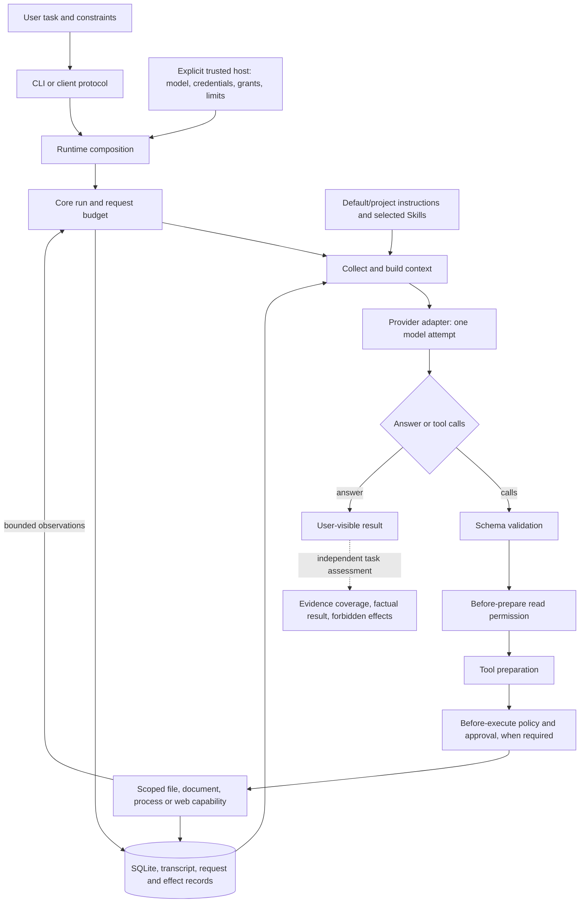

# System overview and current engineering direction

Start here for the current product, remaining user outcomes and next bounded delivery.
[Architecture](architecture.md) owns layer boundaries, [ADRs](decisions/) own accepted decisions,
[roadmap](roadmap.md) owns future scope, and the [delivery record](tasks/2026-10-26-optimization-plan.md)
retains dated results. Historical failures and obsolete candidate coordinates belong in those
records, not in a second current queue. This overview was reconciled on **2026-10-28**.

## Product and current version

moyyi is a personal general-purpose agent with a self-owned core. It should complete useful tasks
correctly, within the user's authority, with recoverable state and understandable results. A
working loop, normal completion or a large passing test suite does not prove factual correctness.
OpenBot contributes selected document parsing, validation and extraction experience through
moyyi's own ports; [provenance](openbot-provenance.md) records that reuse. It supplies no Bot-cluster
runtime, Server authority, user database or attachment service. Accepted D1–D6 remain in force.

The owner has authorized ongoing development, necessary paid validation, and sequential merge
and installation after review and passing CI. This does not authorize public version publication.
Default live configuration stays Flash + Responses + low, zero retries; daily grants remain
read-only until explicitly enabled. Original tasks and acceptance standards stay unchanged.

| Coordinate | Current evidence |
|---|---|
| Latest product work | M4 candidate on the M3 baseline: explicit experimental Kimi high settings, local help and guarded backup/restore/software rollback. Source checks, external bundle and actual native maintenance passed on `edc5207`; the original source task still strictly fails. The [M4 receipt](tasks/2026-10-28-desktop-m4.md) records separate builds and verdicts. M4 is not fully accepted or installed as the daily app. |
| Installation coordinate | M3 [PR #46](https://github.com/Peerframe/moyyi/pull/46) is installed: source `6eb299340768daf807edf5b223a84f046a16b140`, merged main `85873c7e20a5f705cd78b9c4c0880f2772c29d1d`. Local archive SHA256 `08d801806e332eb41ec2d60bea5da546529647f58d6682546cf910ed7d810a8f`; the installation receipt records native launch and history reopen verification. The unchanged CLI [PR #41 receipt](https://github.com/Peerframe/moyyi/pull/41) remains the CLI installation record: accepted tar SHA256 `76efa10a1b6f07cf575a3cbcfcb68c1d777255125b1460b6474206960b21731e`,394 files. M4 source changes update neither installation. |
| Product acceptance | M3 final source check131 files/2644 tests passed; writes/shell eval8/8 each. External-copy10-case and instrumented native9-case gates passed with synthetic providers. The independent live pair passed the unchanged functional/recovery checks in5 repair+3 undo requests; its answer still contains an incorrect extra DOM claim. The sealed first group remains failed. M2 and earlier CLI evidence remain separate; no M4 or general reliability claim. |
| Previous evidence-only delivery | [PR #36](https://github.com/Peerframe/moyyi/pull/36), merged `ae960de` with [main CI passed](https://github.com/Peerframe/moyyi/actions/runs/40421088168): user-requested source-derived check, controlled report repair and readback. Offline check2,433 passed; actual installed workflow passed once in5 requests. Its original task failures remain separate. |
| Optional Kimi | Installed opt-in `kimi-k3.1-pro` Chat provider supports low/high/max and reasoning continuation; desktop M3 presets use low. M4 exposes explicit low/high for Kimi only, with high labelled experimental; Flash remains low. The earlier high control returned first-request429 with no answer. The new actual-desktop high trial completed in5 requests but still strictly failed the original six-item rubric, as did Kimi low; this is now measured failure, not merely untested wiring. |
| Public version | None; local candidate installation and public source PRs are not a version release. |

## What the user can do

The table states demonstrated behavior, not a reliability rate. Detailed commands and limitations
are linked; [the delivery record](tasks/2026-10-26-optimization-plan.md) preserves exact runs,
failures, later corrections and private evidence coordinates.

| User outcome | Available evidence | Remaining boundary |
|---|---|---|
| Start, find work and resume | [Desktop](desktop.md): installed M3, accepted M1/M2 workflows and M3 native approval/cancel/reopen/draft/undo checks; final installation receipt confirms native launch and history reopen | macOS arm64 only, one SQLite writer. The instrumented native fixture is separate from production credential and live semantics evidence. New/reopened sessions remain read-only. |
| Read files and explain a project | Guarded path discovery/search/ranges (navigation enabled in the daily host), readable numbered source, complete next-request delivery; original public report task passed | Complex Skills explanation still fails the original rubric. More available text is not a factual verifier. |
| Read PDF/DOCX/XLSX/PPTX/ODT/ODS/ODP | [Native parser](documents.md), actual installation/containment on Linux/macOS; both fixed comparison/report tasks also passed through the M2 native UI with actual approved files and readback | Body text only; no OCR, legacy/macro files, formula calculation or visual-layout claim. Larger/repeated tasks unmeasured. |
| Modify, check and undo | M3 external-copy/native gates plus one independently authorized live repair/check/reopen/two-snapshot reverse undo passed against the unchanged checker and original bytes/mode | First live repair remains FAIL; the passing repair added an incorrect DOM explanation. File inspection proves bytes at check time, not mode, undo readiness or task correctness. |
| Continue longer work | [SQLite and compaction](long-sessions.md); real eight-turn conversation across process reopen/summary/reopen preserved all ten checked facts/constraints | One bounded semantic case, not general long-session reliability. |
| Read actual websites | [Web](web.md) fetched full RFC8259; a new copied-session revision passed the unchanged task in4 requests: two edits, a complete7,691-byte read and five independently checked facts | The original first report/revision failures remain. The new trial follows explicit human feedback; autonomous correction, search-service/Anthropic live use and general reliability remain unverified. |
| Transform ordinary data/documents | Exact quoted CSV transformation, formatting-preserving worksheet edit and a new unchanged roster merge task passed with actual outputs | Roster fields/older phone fallback/leading zeros passed independent review, but the model's commands inspected bytes/counts/hashes only. The separate explicit ledger verification workflow repaired an error once; autonomous source-derived verification remains unproven. |
| Apply guidance and Skills | [Root instructions](instructions.md), explicitly selected [Skills](skills.md), refresh/authority/replay conformance | Correct loading does not guarantee guidance quality; nested instructions are not auto-discovered. |
| Back up, restore or roll back locally | M4 implements the [maintenance contract](desktop.md#backup-restore-and-software-rollback-m4-candidate) through a trusted local helper; external bundle and actual native backup/restore/rollback passed in an isolated HOME | Current daily M3 does not include this feature. Native restore preserved current settings/workspace and rescued both prior sessions; confirmed software rollback reopened M3 with readable history, without replay or paid model calls. Offline guards cover incompatible settings and unverified old receipts. |

## One task through the whole system

The assessment box is an engineering activity, not a hidden production truth checker. A model
claim, plan status or successful tool return cannot certify that the user's task is correct.
Instructions and source text can inform the model; they cannot grant tool authority. Persistence,
recovery and cancellation apply throughout the loop, not only after an answer.

## Locate the right owner before choosing a fix

| Concern | Implementation entry | First evidence to consult |
|---|---|---|
| Wrong launch/configuration/version | [CLI program](../src/cli/program.ts), [runtime composition](../src/runtime/index.ts) | [Installation](installation.md), [client protocol](client-protocol.md), actual host/package identity |
| Incorrect source navigation or unhelpful tool output | [fs plugin](../src/plugins/fs/index.ts), [file capability](../src/runtime/files.ts), [argument validator](../src/runtime/validation.ts); installed [path-navigation plugin](../src/plugins/workspace-navigation/index.ts) | [File contract](files.md), `eval:files`, actual tool arguments/results |
| Evidence omitted from the model request | [Context collector](../src/runtime/instructions.ts), [context builder](../src/context/index.ts), [core loop](../src/core/index.ts) | [Context tests](../src/context/index.test.ts), request records, `eval:instructions` |
| Evidence arrived but answer is wrong | [Provider](../src/plugins/provider-deepseek/), model configuration and complete request; default guidance as one input | Fixed-source final answer versus required facts; [runtime task evaluation](runtime-evaluation.md). Do not assume a transport or retrieval bug. |
| Wrong tool execution/authority | [Executor](../src/core/executor.ts), [policy](../src/policy/index.ts), capability implementation | Effect/policy tests, [threat model](threat-model.md), actual side effects; never repair by loosening a grant |
| Lost state, repeats, interruption | [Core](../src/core/index.ts), [store](../src/store/), request/recording paths | [Recovery tests](../tests/core-recovery.test.ts), `eval:long-sessions`, journal and transcript |
| Misleading success or comparison | [Task runner](../evals/harness/runner.ts), [runtime adapter](../evals/agents/moyyi.ts), [task selection](../evals/cli.ts) | [Corpus](../evals/corpus.md), actual capabilities, [comparison protocol](research/harness-comparison.md) |

## Remaining failures and closed diagnostic routes

| Observation | What the evidence establishes | What not to infer or repeat |
|---|---|---|
| Original Skills investigation | Restored Flash8: items1/2/3/5 met,4/6 partial. Actual reader/core/render chain now read and explained; enabled-selection rebuild and automatic-reference boundaries omitted. All20 results reached next/final requests. | Strict overall FAIL and old four-request failures remain. The omissions partly extend the visible question. Installed product also changed; do not claim isolated budget causality or repeat until green. |
| Ledger amount association | In the clarified diagnostic, both98-byte CSVs reached every relevant request; the model wrote source-a INV-002 as80 rather than120, then read back its own incorrect report. No compaction or new delivery defect was found. | Readback is not independent validation. Original ledger publication/schema ambiguity remains documented separately. No evidence yet that source-specific default guidance caused the error. |
| Model and effort controls | Frozen low/none decision probes and autonomous Flash/Pro controls did not justify a default change; real provider/tool/terminal observations are recorded separately. | Do not repeat the same question until green, infer stable gains from one arm, or add a mandatory review call that consumes the existing output budget without an answer. |
| Mature-harness comparison | [Pi control](research/harness-comparison.md#pi-responses-control-2026-10-27) ran once:4 actual HTTP200, fifth local request blocked, no answer; six tool results delivered, three late reads not delivered. | Native guidance/tools, no moyyi navigation/countdown/final-none, timing/cache differences preclude causal ranking. Pi is not a product dependency. Earlier unsupported Codex/OpenCode routes remain closed at their documented boundaries. |
| Concrete runtime defects already fixed | [Missing-path diagnosis](decisions/0033-confirmed-missing-read-diagnostics.md), [incomplete response outcomes](decisions/0034-incomplete-response-outcomes.md), and [premature read truncation](decisions/0026-readable-evidence-and-action-budget.md#read-budget-correction-2026-10-27) have source/package/CI/installation evidence. | They do not explain every semantic error. Do not reopen or retest unchanged mechanisms without a new failure or changed dependency. |

Current source audit rechecked actual request roles, supported reasoning continuation and exact
returned text. It found no new provider/context defect. The old ledger run deliberately lacked
shell authority even though its task did not forbid commands. Capability configuration and the
choice of independent verification must therefore be investigated separately from transport and
model interpretation. This is not evidence to broaden the default grants silently.

## Current delivery and next boundary

**Product target: an installed personal desktop candidate with complete user workflows.**
The owner has requested a whole-product plan after finding the CLI candidate less complete in
use than OpenBot. GUI is now the next product priority, alongside a separate answer-quality lane.
The [roadmap](roadmap.md#current-target-a-usable-personal-desktop-candidate) is the single delivery
sequence: M1 installed read-only desktop loop; M2 settings/materials/actual reports; M3 controlled
editing/recovery/undo; M4 combined installed acceptance. M1 established the thin Electron/React
client with bundled Node26 and narrow OpenBot approval reuse. M2 extends this same client and
host without adding a task engine, external service or dependency.

| Current milestone | Usable baseline / demonstrated limit | Next bounded checkpoint | Actual blocker |
|---|---|---|---|
| M1 desktop loop: accepted baseline | External-bundle native startup/directory/approval/read; real host/SQLite/recovery and parser containment passed. One live Flash task used2 requests, zero retries: four exact facts/source, unchanged file/config; reopen added0 requests and changed no entries/effects. See [desktop guide](desktop.md). | Reuse the unchanged [PR #44 receipt](https://github.com/Peerframe/moyyi/pull/44) while extending the accepted M2 baseline | No unresolved M1 code blocker |
| M2 materials/settings/reports: accepted baseline, retained in installed M3 | Source check128 files/2610 tests, external-copy bundle/settings/containment gates and native helper UUID lifecycle passed. Both unchanged native-UI document tasks passed, each4 requests with seven real parses, one approved create and readback; preview/Finder observed. Final integration/install in [PR #45](https://github.com/Peerframe/moyyi/pull/45). | Reuse unchanged task evidence and retain affected integration gates in M4 | Separate `security` CLI helper-key read timed out after30 seconds; no desktop-to-CLI credential-sync claim |
| M3 edit/undo workflows: accepted installed baseline | Final check131/2644, external-copy10-case and instrumented native9-case gates passed. Independent live repair5 requests/51.047s and two-snapshot undo3/30.123s passed; installed source6eb2993/main85873c7, Flash3/120 defaults. | Preserve its files, authority and original task checks during M4 integration | First group remains sealed FAIL; the passing repair answer includes a false extra DOM claim. Unknown effects retain protective leases; no automatic unlock. This is not M4 acceptance |
| Quality lane: unresolved | Actual-desktop Kimi high is sealed:5 requests,22 successful reads,138.996s, end_turn, unchanged source; original rubric still FAIL, items1/2/3/5 met and4/6 partial. Earlier unavailable/failed trials and withdrawn notes remain separate | Close this trial; public lifecycle/dataflow tasks were not triggered and each used0 requests. Any completion-contract route needs its own architecture/acceptance decision, not an automatic judge implementation | Selection-recreation and no-automatic-script-execution explanations remain incomplete despite actual source reads. This does not block independent maintenance acceptance |
| M4 integrated target: engineering candidate checked, not fully accepted | Clean source `edc5207` check136/2678 and external-bundle M1/M2/M3, settings and maintenance gates passed. Actual native backup, rescue restore, cancelled/confirmed software rollback and automatic history reopen passed with0 maintenance model calls | Submit the reviewed candidate and CI evidence; keep the daily M3/CLI PR41 unchanged while the source-task gate fails. Reuse unaffected M2/M3 task evidence | Original source strict FAIL remains. Conditional public tasks were not triggered; full M4 merge/daily installation is not accepted. Minimum-window and other-platform native maintenance remain unverified |

The GUI uses the self-owned core through a narrow client boundary. It neither replaces core
permissions with UI states nor imports OpenBot's Bot/team/Server architecture. Approval and
result-card presentation reuse is [recorded](openbot-provenance.md).
The desktop uses actual runtime commands/events; scripted tests and live task evidence remain
separate. Original task standards stay intact; an honest limited candidate may be inspected
before M4, but the full target is not complete while its required source-analysis task fails.

**Current result: the isolated-evidence candidate was withdrawn; M4 is still unaccepted.**
[ADR 0041](decisions/0041-isolated-evidence-review.md) preserves the whole-chain diagnosis and
one new experiment, not an enabled feature. Candidate `32545fc` used6 actual Kimi high requests
under the unchanged8/300/8192 limits. The sixth response was interrupted at the original time
limit; partial visible text was retained, but neither evidence review nor final-answer stage ran.
There is no complete answer to grade, so this does not establish a repair of the two old omissions
or a semantic verdict on isolated review. The two conditional public tasks remain untriggered.
The trial is sealed without retries or quota transfer. Product/runtime/UI experiment code was
removed; the retained engineering improvement makes packaged settings checks pass through the
actual desktop communication boundary. Flash defaults and daily M3 remain unchanged. PR47 stays
draft and unmerged; no public release. The earlier completed-answer result below is separate.

The new actual-desktop Kimi high trial used5 requests and22 successful read tools in138.996 seconds,
within8/300/8192 and zero retries. Source bytes were unchanged and the answer ended normally.
Independent original-rubric review still finds items1/2/3/5 met and4/6 partial: it now explains
no automatic reference loading, but omits the operational need to recreate runtime for selection
changes and the explicit no-automatic-script-execution boundary. Relevant implementations were
actually read; no new material false claim was confirmed. The two conditional public tasks were
not triggered and each used0 requests. No follow-up repairs this sealed answer.

Current runtime/desktop context differs from the old isolated control, so this is not an
effort-only causal comparison. The daily Flash3/120 settings were restored through the UI with
their original file hash unchanged. The [M4 receipt](tasks/2026-10-28-desktop-m4.md) retains the
fixed inputs, verdict and a bounded three-project source review. Plan/schema state and model
judges do not independently establish factual completeness. A new completion contract requires
a separate decision about evidence and acceptance; no automatic critic or new task framework is
added to this delivery. M4 remains unaccepted while its original source-analysis gate fails.

**Closed diagnostic routes remain closed.**
The structured-findings candidate was withdrawn after one unchanged original-task trial. Eight
Flash/Responses/low requests completed, all16 tool results, including the notes, reached the final request,
and source bytes stayed unchanged. The notes never formed the two missing propositions and
introduced an incorrect raw-metadata conclusion. Independent old-rubric result: items1/5 met,
2/4/6 partial,3 wrong. Offline24 focused checks/full2,577 tests establish only the rejected
candidate's transport/limits. No notes plugin, new prompt or automatic review stage is installed.

The owner then authorized one Kimi high control using the original isolated runtime, question,
source, system/tools and8-request/300-second/8,192-output ceiling. Offline14 gates and nine synthetic
requests passed. Its first actual request returned429 `engine_overloaded_error`, with no answer,
no tool calls, unknown usage and zero retries. That earlier isolated trial is unavailable semantic
evidence and has no answer-rubric score; it is separate from the new completed high FAIL above.
The [official troubleshooting guide](https://platform.kimi.com/docs/guide/troubleshooting)
identifies this subtype as server capacity, distinct from quota or organization rate limits;
changing moyyi's prompts or adding credits is not an established remedy. The sealed trial is not
reopened. A later availability-backed validation must be separately recorded within unchanged
limits, not used to reroll a completed bad answer. No alternative model/region was substituted.

The verified complex-task recommendation and conditional public lifecycle/dataflow trials have
**not** passed their gate. The candidate's explicitly labelled high selector does not imply that
recommendation. The installed PR41 CLI/M3 desktop and daily Flash low, read grants, max3 and zero
retries remain unchanged. The [research record](research/2026-10-26-agent-navigation.md#form-findings-during-investigation-2026-10-27)
and [dated delivery record](tasks/2026-10-26-optimization-plan.md) retain rejected code, exact trial
identities and known limits. Do not repeat generic completeness prompts, expand retrieval, or
report service failure as evidence that high cannot solve the task.

**Previous bounded result: Kimi connects correctly, but does not pass the unchanged source rubric.**
The owner selected official Kimi Open Platform and saved the regional key. A separate synthetic
Responses probe returned HTTP200 then HTTP400 for final `tool_choice:none`; Chat completed the
tool/result/final-none flow in two HTTP200 requests. [ADR 0036](decisions/0036-kimi-chat-provider.md)
and [host setup](kimi.md) define the opt-in integration. Flash/Responses/low remains the daily default.

One independent Kimi/Chat/low original-task trial used six HTTP200, zero retries, within the same
eight-request/300-second limits (297.347 seconds including local setup/cleanup). It used the
original `4e3cddb` runtime package in isolation, source1838248, unchanged prompt/six-item rubric,
identical common system/tool definitions and read/list/search authority. Thirty-two tool results
reached the exact next and final requests; all140 source files were unchanged. The old Flash
trial remains sealed. Protocol, provider reasoning semantics, context profile, timing and cache
state differ, so this is not an isolated model-weight comparison or a reliability estimate.

Kimi explains the main collection/permission/render chain, inert allowed-tools and size/failure
handling. It still omits the explicit requirement to rebuild runtime when changing the enabled
selection and the prohibition on automatic reference/script loading. Items1/2/3/5 meet the old
standard;4/6 remain partial: strict overall FAIL. Two secondary wording limits remain: the JSON
field is `text` (the answer ambiguously lists markdown), and the internal combined-budget error
is sanitized before it escapes, a detail the answer does not explain. Do not count a longer answer or more retrieved
files as improvement in the acceptance result. No additional retry, follow-up prompt or hidden
rubric was supplied. The next quality work concerns answer coverage/interpretation, not wider
retrieval or more grants. This result does not justify changing the default model.

**Previous bounded result: the unchanged roster merge task passed; autonomous source-derived
verification was not demonstrated.** One installed Flash/Responses/low trial used5 HTTP200, zero
retries and14.345 seconds within the existing15-request/180-second ceiling. The original task,
fixtures and checker were unchanged; only merged.csv was writable, with the existing read-only
Node sandbox available and no network/credentials inside commands. No check command or expected
answer was supplied. All203 output bytes match an independently derived result: latest records,
older nonempty phone fallback, duplicate removal and leading zeros are correct. Two source files
and modes/canary stayed unchanged; all five tool results reached the next/final requests exactly.

The model selected `wc`, hashes and an `od` byte dump, not an independent recomputation of the
merge rules. Its first compound command included unsupported macOS `cat -A`; later subcommands
returned zero, and the model then chose `od` in the next request. Do not treat aggregate exit0
as proof that every subcommand succeeded. Final facts are correct; its claim that string comparison
was actually applied overstates observable evidence (the output matches that order). Preserve
this nonblocking wording issue. Task PASS does not establish general reliability or the separate
verification-selection metric; the absent metric alone does not identify a core defect.

The trial is sealed, without retries or follow-up prompts. The owner has unchanged inputs/output
and the original final answer. No program, daily host or default authority changed. The existing
[delivery record](tasks/2026-10-26-optimization-plan.md) retains exact coordinates and preparation
failures; original source/ledger/web results remain unchanged. The source question now also has
an explicitly engineering-reviewed correction, separate from the model answer and its FAIL score.

**Delivered result: the original web revision task passed on the installed product.**
One copied-session trial started from the original uncorrected9,264-byte report and unchanged
revision prompt. Flash/Responses/low used4 HTTP200, zero retries, within the original4-request/
180-second ceiling. Two edits were followed by a new complete107-line/7,691-byte `read` and final
answer. All three results reached the next/final requests exactly. Independently, the last write's
complete postcheck matched disk bytes/hash and reached the next/final request. Neither metric
replaced the explicit read requirement. Five facts, section references,17 block quotations and
the stated limits were independently checked against the historical RFC receipt; task PASS.
One nonblocking revision-note phrase says section2's conclusion was unchanged although its wording
was narrowed; the core propositions/quotations remained and the final answer acknowledges the edit.
Do not describe this as flawless output. Only report.md changed; original evidence/canary stayed
unchanged and the temporary workspace was removed. The trial is sealed, without further calls.

This proves revision after explicit human feedback, not autonomous error discovery or a causal
quality gain from postcheck. No new web/shell call was made. The old web failures and source-eight
ledger remain sealed and are not rescored. Full private coordinates and token usage are in the
[delivery record](tasks/2026-10-26-optimization-plan.md); the owner has an unchanged report copy.

**Delivered implementation: verified write observations.**
The runtime already checks actual disk bytes after a controlled edit; the fs tool previously
returned only hashes and a snapshot. [ADR 0035](decisions/0035-verified-write-observations.md)
returns that existing observation with independent read authority, bounded content and explicit
availability/truncation. It adds no model request or file read and does not certify facts.
Original web revision readback and source-question failures are not rescored. Source, external
package and actual owner installation verification passed; product CI and fixed code review passed.
Final integration coordinates are recorded in PR #37. The bounded live observation/revision trial
above now provides actual installed evidence; this documentation-only delivery does not reinstall
the identical program or change daily authority.

**Closed trial: the original question with its restored eight-request ceiling.**
The owner explicitly approved one trial on2026-10-27; it used8 HTTP200, zero retries and no
write/shell/web authority. Source1838248, question and six-item rubric were unchanged; public-task
pass reused. The reader/core chain is now covered; items1/2/3/5 met and4/6 partial, overallFAIL.
All20 tool results reached subsequent/final requests and140 source files stayed unchanged.
The two omitted boundaries were available; no new transport defect was found. Preserve older
four-request evidence and the newer installed-product difference. The
[audit](research/2026-10-26-agent-navigation.md#original-task-boundary-audit-2026-10-27) does not
justify another index, wider grants or more same-question calls. This turn's8 requests are spent.

**Established result: a report checked against its original sources and repaired.**
Use the existing [independent verification recipe](recipes/verify-a-result.md). A reviewed,
visible check script derives expected candidates from the sources; the model cannot edit the
sources or script. The actual installed readonly Node tool reported the initial failure, controlled editing corrected
only the report, the same command passed, and complete 288-byte readback entered the final model
context. Five real requests, nine tool results, source/check integrity and final claims were
checked independently; one unauthorized compound command was denied. The final report remains
blocked on a business conflict. This used scoped automatic policy, not a TTY approval exercise.

The separate `verified-ledger-repair` task retains15 requests/180seconds, Flash/Responses/low and
zero retries. This is a new explicit verification workflow, not another original-ledger attempt
or a replacement for the original4+4 scores. The corpus has33 tasks; the original32 and separate
document acceptance group retain their fixtures and checkers. Scripted/checker tests prove the
mechanism only; this separate installed live result proves the explicit workflow once. It supports
using an independent source check when available, but does not establish autonomous selection or
causal accuracy gains. No stop-hook framework, provider switch or new core port was necessary.

The full objective remains open: original investigation criteria, representative factual
accuracy and autonomous selection of appropriate verification still need adequate evidence.
The web revision closeout is complete; it cannot substitute for those outcomes. Editing/undo, long-session and document results
already have bounded live evidence and need not be rerun merely to fill another checklist.

## Boundaries and maintenance

- GUI, demand-driven MCP, long-term memory, OCR, optional Docker and Qwen/shasha training remain
  [deferred](roadmap.md). Do not start them to avoid a current accuracy problem.
- Keep original standards, versioned persistent data, default read-only authority and existing
  request/output limits. Public publication still needs separate authorization.
- Before a substantial change, name the user outcome, relevant path through the diagram,
  observed failure and finite exit condition. Reuse maintained public solutions when a route
  fails; research must settle a concrete choice rather than indefinitely postpone delivery.
- Update this current overview and the existing delivery record together. Retain dated results
  there instead of repeatedly expanding this page with historical narratives. Distinguish
  installed, scripted, live-passed, failed and unmeasured; preserve private transcripts and keys.
