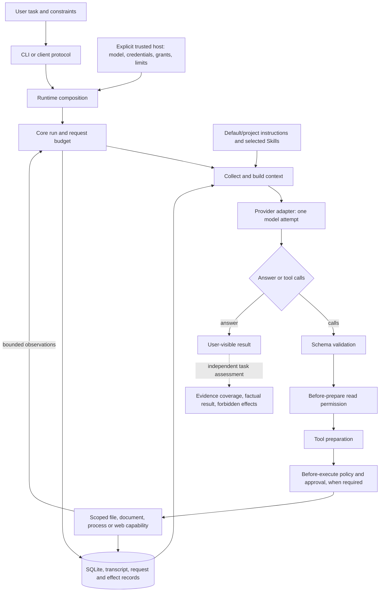

# System overview and current engineering direction

Start here for the current product, remaining user outcomes and next bounded delivery.
[Architecture](architecture.md) owns layer boundaries, [ADRs](decisions/) own accepted decisions,
[roadmap](roadmap.md) owns future scope, and the [delivery record](tasks/2026-10-26-optimization-plan.md)
retains dated results. Historical failures and obsolete candidate coordinates belong in those
records, not in a second current queue. This overview was reconciled on **2026-10-27**.

## Product and current version

moyyi is a personal general-purpose agent with a self-owned core. It should complete useful tasks
correctly, within the user's authority, with recoverable state and understandable results. A
working loop, normal completion or a large passing test suite does not prove factual correctness.
OpenBot contributes selected document parsing, validation and extraction experience through
moyyi's own ports; [provenance](openbot-provenance.md) records that reuse. It supplies no Bot-cluster
runtime, Server authority, user database or attachment service. Accepted D1–D6 remain in force.

The owner has authorized ongoing development, necessary paid validation, and sequential merge
and installation after review and passing CI. This does not authorize public version publication.
Default live configuration stays Flash + Responses + low, zero retries; daily grants remain
read-only until explicitly enabled. Original tasks and acceptance standards stay unchanged.

| Coordinate | Current evidence |
|---|---|
| Last merged product change | [PR #35](https://github.com/Peerframe/moyyi/pull/35), `8ab4054eac2607ae9e35129951de5abcdc2b605f`; [merged main Linux/macOS CI](https://github.com/Peerframe/moyyi/actions/runs/40416058220) passed. Verify Git before editing. |
| Installed product | `4e3cddb1a8243c925a469edf73f17121b20dfa92`; all372 files match tar SHA256 `4d7bb7122b1a6cd758e3010a374befc0f455675d29bb3e96e867c17a93896278`. Packaged inputs match merged main; nonpackaged evidence/eval updates do not require reinstalling the same program. |
| Product acceptance | Check2,407 tests, files19/19, external CLI12/client13/documents9, isolation/strict types/PTY7 and product/final-head CI passed. Actual owner client13/CLI12 and old-session resume/help/exit passed without a model call. Sessions/config backed up and PR #34 package retained. |
| Current evidence delivery | `codex/verified-report-workflow`: a user-requested source-derived check, controlled report repair and readback using existing capabilities. No core/provider/default-guidance change. Offline check2,433 tests passed; one actual installed workflow passed in5 requests, zero retries. Original failures remain separate. |
| Public version | None; local candidate installation and public source PRs are not a version release. |

## What the user can do

The table states demonstrated behavior, not a reliability rate. Detailed commands and limitations
are linked; [the delivery record](tasks/2026-10-26-optimization-plan.md) preserves exact runs,
failures, later corrections and private evidence coordinates.

| User outcome | Available evidence | Remaining boundary |
|---|---|---|
| Start, find work and resume | [CLI](cli.md), cross-workspace catalog/receipts, actual installed startup and reopen passed | Live credentials come from an explicit trusted host; old session state does not grant current authority. |
| Read files and explain a project | Guarded path discovery/search/ranges, readable numbered source, complete next-request delivery; original public report task passed | Complex Skills explanation still fails the original rubric. More available text is not a factual verifier. |
| Read PDF/DOCX/XLSX/PPTX/ODT/ODS/ODP | [Native parser](documents.md), actual installation/containment on Linux/macOS, two fixed live comparison/report tasks passed | Body text only; no OCR, legacy/macro files, formula calculation or visual-layout claim. Larger/repeated tasks unmeasured. |
| Modify, check and undo | [Controlled writes](writes.md) plus [read-only Node commands](shell.md); one live repair/check/undo restored original bytes/mode/failure; actual everyday CLI repair/check/readback passed | Independent source/test checks are needed for meaning. A write postcheck verifies bytes, not task correctness. |
| Continue longer work | [SQLite and compaction](long-sessions.md); real eight-turn conversation across process reopen/summary/reopen preserved all ten checked facts/constraints | One bounded semantic case, not general long-session reliability. |
| Read actual websites | [Web](web.md) fetched full RFC8259 and produced/read a report with five required correct facts | Two incidental claims needed revision; corrected file was independently checked but the model omitted final revision readback. Search-service/Anthropic live use remains unverified. |
| Transform ordinary data/documents | Exact quoted CSV transformation and formatting-preserving worksheet edit passed with actual outputs/readback | A ledger report still associated a delivered amount with the wrong invoice. The new explicit verification workflow detected and repaired that type of error once; autonomous verification remains unproven. |
| Apply guidance and Skills | [Root instructions](instructions.md), explicitly selected [Skills](skills.md), refresh/authority/replay conformance | Correct loading does not guarantee guidance quality; nested instructions are not auto-discovered. |

## One task through the whole system

The assessment box is an engineering activity, not a hidden production truth checker. A model
claim, plan status or successful tool return cannot certify that the user's task is correct.
Instructions and source text can inform the model; they cannot grant tool authority. Persistence,
recovery and cancellation apply throughout the loop, not only after an answer.

## Locate the right owner before choosing a fix

| Concern | Implementation entry | First evidence to consult |
|---|---|---|
| Wrong launch/configuration/version | [CLI program](../src/cli/program.ts), [runtime composition](../src/runtime/index.ts) | [Installation](installation.md), [client protocol](client-protocol.md), actual host/package identity |
| Incorrect source navigation or unhelpful tool output | [fs plugin](../src/plugins/fs/index.ts), [file capability](../src/runtime/files.ts), [argument validator](../src/runtime/validation.ts); candidate [navigation plugin](https://github.com/Peerframe/moyyi/tree/69312969533659578cc1da21b510d8395a099ef3/src/plugins/workspace-navigation) | [File contract](files.md), `eval:files`, actual tool arguments/results |
| Evidence omitted from the model request | [Context collector](../src/runtime/instructions.ts), [context builder](../src/context/index.ts), [core loop](../src/core/index.ts) | [Context tests](../src/context/index.test.ts), request records, `eval:instructions` |
| Evidence arrived but answer is wrong | [Provider](../src/plugins/provider-deepseek/), model configuration and complete request; default guidance as one input | Fixed-source final answer versus required facts; [runtime task evaluation](runtime-evaluation.md). Do not assume a transport or retrieval bug. |
| Wrong tool execution/authority | [Executor](../src/core/executor.ts), [policy](../src/policy/index.ts), capability implementation | Effect/policy tests, [threat model](threat-model.md), actual side effects; never repair by loosening a grant |
| Lost state, repeats, interruption | [Core](../src/core/index.ts), [store](../src/store/), request/recording paths | [Recovery tests](../tests/core-recovery.test.ts), `eval:long-sessions`, journal and transcript |
| Misleading success or comparison | [Task runner](../evals/harness/runner.ts), [runtime adapter](../evals/agents/moyyi.ts), [task selection](../evals/cli.ts) | [Corpus](../evals/corpus.md), actual capabilities, [comparison protocol](research/harness-comparison.md) |

## Remaining failures and closed diagnostic routes

| Observation | What the evidence establishes | What not to infer or repeat |
|---|---|---|
| Original Skills investigation | Latest autonomous Flash4: items1/3/4/5 met,2/6 partial; reader/core chain not fully read and one delivered boundary omitted. Actual tool results reached subsequent requests. | Keep the failure. Root/enabled rebuild and reference-loading requirements partly extend the visible question; the prompt says8 but this comparison enforces4. Do not relabel old8 and new4+4 as equal budgets or inject rubric answers. |
| Ledger amount association | In the clarified diagnostic, both98-byte CSVs reached every relevant request; the model wrote source-a INV-002 as80 rather than120, then read back its own incorrect report. No compaction or new delivery defect was found. | Readback is not independent validation. Original ledger publication/schema ambiguity remains documented separately. No evidence yet that source-specific default guidance caused the error. |
| Model and effort controls | Frozen low/none decision probes and autonomous Flash/Pro controls did not justify a default change; real provider/tool/terminal observations are recorded separately. | Do not repeat the same question until green, infer stable gains from one arm, or add a mandatory review call that consumes the existing output budget without an answer. |
| Mature-harness comparison | [Pi control](research/harness-comparison.md#pi-responses-control-2026-10-27) ran once:4 actual HTTP200, fifth local request blocked, no answer; six tool results delivered, three late reads not delivered. | Native guidance/tools, no moyyi navigation/countdown/final-none, timing/cache differences preclude causal ranking. Pi is not a product dependency. Earlier unsupported Codex/OpenCode routes remain closed at their documented boundaries. |
| Concrete runtime defects already fixed | [Missing-path diagnosis](decisions/0033-confirmed-missing-read-diagnostics.md), [incomplete response outcomes](decisions/0034-incomplete-response-outcomes.md), and [premature read truncation](decisions/0026-readable-evidence-and-action-budget.md#read-budget-correction-2026-10-27) have source/package/CI/installation evidence. | They do not explain every semantic error. Do not reopen or retest unchanged mechanisms without a new failure or changed dependency. |

Current source audit rechecked actual request roles, supported reasoning continuation and exact
returned text. It found no new provider/context defect. The old ledger run deliberately lacked
shell authority even though its task did not forbid commands. Capability configuration and the
choice of independent verification must therefore be investigated separately from transport and
model interpretation. This is not evidence to broaden the default grants silently.

## Current delivery and next boundary

**Established result: a report checked against its original sources and repaired.**
Use the existing [independent verification recipe](recipes/verify-a-result.md). A reviewed,
visible check script derives expected candidates from the sources; the model cannot edit the
sources or script. The actual installed readonly Node tool reported the initial failure, controlled editing corrected
only the report, the same command passed, and complete 288-byte readback entered the final model
context. Five real requests, nine tool results, source/check integrity and final claims were
checked independently; one unauthorized compound command was denied. The final report remains
blocked on a business conflict. This used scoped automatic policy, not a TTY approval exercise.

The separate `verified-ledger-repair` task retains15 requests/180seconds, Flash/Responses/low and
zero retries. This is a new explicit verification workflow, not another original-ledger attempt
or a replacement for the original4+4 scores. The corpus has33 tasks; the original32 and separate
document acceptance group retain their fixtures and checkers. Scripted/checker tests prove the
mechanism only; this separate installed live result proves the explicit workflow once. It supports
using an independent source check when available, but does not establish autonomous selection or
causal accuracy gains. No stop-hook framework, provider switch or new core port was necessary.

The full objective remains open: original investigation criteria, representative factual
accuracy and the outstanding web revision closeout still need adequate evidence. One repaired
report cannot substitute for those outcomes. Editing/undo, long-session and document results
already have bounded live evidence and need not be rerun merely to fill another checklist.

## Boundaries and maintenance

- GUI, demand-driven MCP, long-term memory, OCR, optional Docker and Qwen/shasha training remain
  [deferred](roadmap.md). Do not start them to avoid a current accuracy problem.
- Keep original standards, versioned persistent data, default read-only authority and existing
  request/output limits. Public publication still needs separate authorization.
- Before a substantial change, name the user outcome, relevant path through the diagram,
  observed failure and finite exit condition. Reuse maintained public solutions when a route
  fails; research must settle a concrete choice rather than indefinitely postpone delivery.
- Update this current overview and the existing delivery record together. Retain dated results
  there instead of repeatedly expanding this page with historical narratives. Distinguish
  installed, scripted, live-passed, failed and unmeasured; preserve private transcripts and keys.
