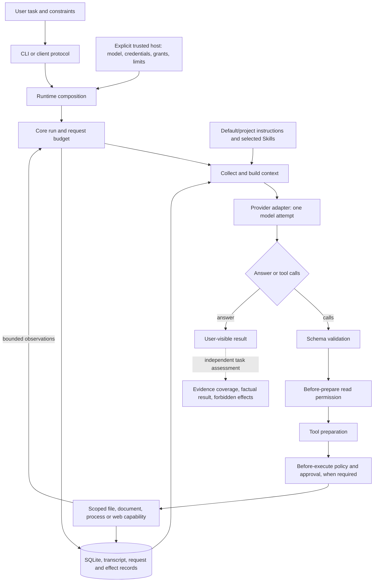

# System overview and current engineering direction

This is the starting point for reasoning about moyyi as a product. It connects user outcomes,
implementation owners, evidence and the next delivery. It is not another layer specification:
[architecture](architecture.md) owns boundaries, [ADRs](decisions/) own decisions,
[roadmap](roadmap.md) owns future scope, and dated [task records](tasks/) preserve historical results.

## Product goal and current checkpoint

moyyi is a new personal, general-purpose agent with a self-owned core. Success means completing
useful tasks correctly, within the user's authority, with recoverable state and understandable
results. A working loop or a large passing test suite is necessary but does not establish that
success. OpenBot contributes selected technology and failure experience through moyyi's own
contracts; it does not supply a bot-cluster architecture. Model training, including shasha/Qwen,
is deferred. Accepted D1–D6 remain in force.

**Current checkpoint: verified daily workflows.** Seven-format document reading is merged and
both fixed live document tasks passed. The owner has authorized necessary paid validation and
sequential review/CI/merge/install for this continuing product goal; official publication remains
separate. Installed live trials now cover controlled edit/check/undo, long-session fidelity and real
web reading. An explicit everyday CLI entry for these grants is now installed and has a live task result. The fresh original 4+4 regression now passes public report delivery; the complex Skills
explanation still fails its original rubric and is not relabeled as solved. A real eight-turn
conversation, process reopen, compaction and further reopen preserved all ten checked facts and
constraints. OCR, demand-driven MCP/GUI/memory and model training stay deferred.

## Version and evidence coordinates

Audited on **2026-10-27**. These are evidence snapshots, not moving branch guarantees; check Git
and the referenced PR before changing code. No current authorization is inferred from old records.

| Coordinate | Audited state | What it means |
|---|---|---|
| Prior merged baseline | `448fb2a246d327f45a1329dc920eb7c473e59ee0`, through [PR #29](https://github.com/Peerframe/moyyi/pull/29) | Independent review found no blocker; final-head CI and [merged main CI](https://github.com/Peerframe/moyyi/actions/runs/40359647505) passed. The first main macOS job acquired no runner and was cancelled before any steps; a job-only rerun passed without changing the head or workflow. |
| Prior product delivery | [PR #30](https://github.com/Peerframe/moyyi/pull/30), product `8eb8317362994a46704ee965559c0a89725b4b22` | Confined macOS heredocs/Node stdin, captured shell toolchain metadata and confirmed Linux parser namespace cleanup; [ADR 0031](decisions/0031-confined-command-verification.md). Original check passes 2,311 tests; [Linux/macOS CI](https://github.com/Peerframe/moyyi/actions/runs/40373993007), clean external package and actual owner installation passed. Product hash identifies packaged source; PR status and final CI identify integration. |
| Prior product delivery | [PR #31](https://github.com/Peerframe/moyyi/pull/31), product `106d4130bd2d153c130c1810fa7694e470760848` | Find sessions across workspaces, inspect matching recorded effects/receipts, resume with current grants; [ADR 0032](decisions/0032-session-discovery-and-recorded-results.md). Original check passes 2,350 tests; [Linux/macOS CI](https://github.com/Peerframe/moyyi/actions/runs/40381859391), clean external package and owner installation passed. Independent review found no blocker; integration state is recorded on the PR. |
| Current product delivery | [PR #32](https://github.com/Peerframe/moyyi/pull/32), product `351126b7d7308c7d2c66e58286123d304babff15` | Confirmed initial missing text reads have a distinct bounded diagnosis; [ADR 0033](decisions/0033-confirmed-missing-read-diagnostics.md). Original checks pass 2,380 tests, file conformance 17/17, [Linux/macOS CI](https://github.com/Peerframe/moyyi/actions/runs/40388079129) and clean external package passed. Review found no blocker; integration state is tracked on the PR. |
| Current local installation | Product `351126b`; tar SHA256 `d12a349ef1e02f6e0e55368798af840bd5ba5f09c19fa589851ccaf72597240c` | 372 files match. External CLI 10/10, client 12/12, documents 9/9, isolation, strict types and PTY 7/7 passed. Actual installation opens an existing DeepSeek session for help/catalog/results/exit without model requests. An eight-request scripted installed-runtime preflight confirms missing-path recovery, exact next-request evidence, denied writes and report readback. Backup and prior PR #31 package retained. Host stays Flash + Responses + low, default read-only/max3/zero-retry. |
| Prior command verification installation | Product `8eb8317`; tar SHA256 `28417c7163feb6c61ccad693b567a9e11dbe0a637407e35a0cb68d83e846f1e0` | Actual installed Node heredoc computed from JSON, preserved files, denied workspace write/credentials/network and delivered the exact result to the next scripted request. These unchanged command mechanisms retain their scoped evidence. |
| Prior installed baseline | Product `69312969533659578cc1da21b510d8395a099ef3`; tar SHA256 `12b2aee9c116e432ab23780c32c793adc094708995dc7d7f393a1ac1fe3774a5` | 244-file identity and CLI/client/PTY/offline navigation evidence remain valid for this prior package. The document upgrade has its own acceptance receipt and backup in the [optimization plan](tasks/2026-10-26-optimization-plan.md). Flash + Responses + low, daily read-only/max3/zero-retry settings are retained. |
| Document live acceptance | Installed `e64fa0e`; 2026-10-26, Flash + Responses + low | Both fixed tasks passed their unchanged checkers once: actual comparison/report files, seven facts/hashes/quotes, approved total CNY 5,500, readback and unchanged inputs. Eight HTTP 200 requests, zero retries; each attempted shell once and was denied before using controlled create/read. [Evidence and limits](tasks/2026-10-26-optimization-plan.md#文档真实任务验收2026-10-26). |
| Prior autonomous investigations | Installed `e64fa0e`, 2026-10-26, original4+public4 baseline | Eight HTTP200 requests, zero retries, unchanged snapshots/prompts/rubric/checker. Public source-dataflow report exists and its official checker passes. Original Skills explanation makes a raw-text/parsed-field error and omits consumers/lifecycle. These historical scores are unchanged. |
| Latest autonomous investigations | Installed `351126b`, 2026-10-27, same original4+public4 envelope | Eight HTTP200 requests, zero retries. Public source-dataflow report passes its original checker. Original Skills rubric still fails: items 1/3/5 met, 2/4/6 partial. Raw-text and revocation explanations are now materially correct, but the reader/core chain is untraced and delivered restart/reference rules are omitted. All 14 original tools succeeded, so the new missing-read diagnosis was not exercised; no causal quality improvement claim. |
| Real long-session acceptance | Installed `e64fa0e`, separate processes | Eight live conversation turns, one summary, one follow-up; all ten corrected facts/constraints/pending-state fields correct after reopen. Resume makes no request; original transcript retained; early facts are inside the summarized span. One case, not a universal fidelity claim. |
| Real edit/check/undo acceptance | Installed `487ccfb`, native sandbox | Public listener-leak fixture repaired and checked, then both snapshots undone in reverse order. Original bytes/mode and original failure restored; checker and outside canary unchanged. Eight HTTP200 requests, zero retries. |
| Real web report acceptance | Installed `487ccfb`, explicit DoH | Actual full RFC8259 fetched, report created and read back in four requests; required five facts correct. Two incidental unsupported claims needed human review and a separate four-request revision. Revised bytes independently checked; the model omitted revision readback, so that later workflow is not marked fully passed. |
| Real everyday launcher acceptance | Installed `0a539c7`, actual `moyyi-deepseek start` | Five recorded model attempts, no retry notice; approved edit, readonly native Node checker and exact 1,060-byte readback passed. Whole-file read legitimately omits optional range metadata; an offline supplemental verifier retained the runner failure and checked the original file/results/next context without new calls. No HTTP wire/status capture or general reliability claim. |
| Additional public task sample | Installed `0a539c7`, 2026-10-27, unchanged four tasks and original per-task limits | 16 HTTP200 requests, zero retries. Lifecycle analysis, release evidence audit and website copy/injection tasks passed. Exact release-note transformation omitted one public record and failed despite complete source and output readback. Protected inputs remained unchanged and all separate evidence audits passed. A five-request command-capability control produced a correct first draft but both attempted checks failed; it does not establish a verification fix. |
| Corrected candidate live task | Installed `8eb8317`, original release-note task/checker/15-request/180s limit | Four HTTP200 requests, zero retries; first draft is the exact 271-byte expected file including the previously omitted record. Complete source and final-file readback reached subsequent requests, protected inputs unchanged. No shell call occurred: task correctness passed once, autonomous programmatic checking remains unestablished. The previous 3/4 sample and failed-check control are retained. |
| New daily artifact sample | Installed `351126b`, three previously unexecuted public tasks, original 15-request/180s budgets | 17 HTTP200 requests, zero retries: quoted CSV 6, exact worksheet edit 7, conflicting ledger 4. CSV and worksheet pass their original checkers with actual file/readback evidence. The ledger fails the original checker while honestly reporting partial/blocked; its visible instruction did not explicitly forbid a partial ledger or specify JSON field hierarchy, so attribution includes a task-specification gap. Old scores remain unchanged. |
| Clarified ledger diagnostic | Same installation, one separately labeled post-hoc trial; same fixture/checker/budget | Four HTTP200 requests, zero retries. General publication and top-level-field requirements were added without giving conflict facts. No ledger was produced and the final answer honestly reports blocked. The report still fails: it assigns source-a's INV-001 amount of 80.00 to INV-002 despite complete evidence that source-a.csv lists INV-002 as 120.00. Array-vs-string checker failures remain partly underspecified; the wrong amount independently establishes factual failure. Do not include this variant in original-corpus scores or repeat it until green. |
| Public release | None | Local candidate installation is not npm/GitHub publication or a release tag. |

The merged public corpus has 32 tasks. Two new fixed document tasks are prepared as a separate
acceptance group; they do not change the original task selection or rubrics. Reference/checker tests and scripted
conformance are not real-model corpus results. No same-model, same-budget comparison with a mature
harness has been executed; a [bounded offline feasibility probe](research/harness-comparison.md#bounded-feasibility-check-2026-10-27)
stopped before any model request. Earlier full-source and model/effort diagnostics are recorded in
[PR #25's fixed evidence record](https://github.com/Peerframe/moyyi/blob/650a00b06bcabc308d9cebeffc0e037658eb6457/docs/decisions/0022-evidence-guidance-and-focused-reads.md)
and [reasoning record](https://github.com/Peerframe/moyyi/blob/650a00b06bcabc308d9cebeffc0e037658eb6457/docs/tasks/2026-10-26-configurable-reasoning.md).
Do not repeat those experiments merely because a new contributor has not read them.

## One task through the whole system

The assessment box is an engineering activity, not a hidden production truth checker. A model
claim, plan status or successful tool return cannot certify that the user's task is correct.
Instructions and source text can inform the model; they cannot grant tool authority. Persistence,
recovery and cancellation apply throughout the loop, not only after an answer.

## What can a user do, and what is actually verified?

| User outcome | Entry and dependencies | Available evidence | Remaining limit |
|---|---|---|---|
| Start, find prior work, inspect results and resume | [CLI](cli.md), explicit host, Node/toolchain, credentials for live use | [Installed CLI/PTY/client acceptance](installation.md); PR #31 restart/catalog/results/current-grants workflow and existing-owner-session inspection pass without a model request | Model/credential setup still requires trusted host configuration; explicit daily CLI grants are installed. A successful connection is not task competence. |
| Inspect a project and explain its behavior | File tools, instructions, context, provider and final answer | Real tool continuation and bounded final closeout; candidate source windows, exact scopes, filters and discovery outputs are verified against actual files; opt-in path context and scripted read/create/verify delivery now have offline evidence | The latest live follow-up passes public report delivery but still fails the original Skills explanation criteria. Native tool-text transport is accepted; one trial per task is not a reliability baseline. |
| Change files, inspect changes and undo | [Write grant, approvals, snapshots](writes.md); shell grant if checks need a process | Filesystem/SQLite safety checks plus one real repair/check/undo task with exact content/mode restoration | One task is not an edit reliability rate; daily host remains read-only and grants are available through explicit CLI flags. |
| Run commands and stop them | [Shell plugin](shell.md), explicit process grants, supported native sandbox/toolchain | Native-process conformance and documented platform tests | macOS detached descendants/host hard-kill limitations remain. Docker is a planned optional adapter, not an implemented fallback. |
| Continue long work without losing state | [Store and long sessions](long-sessions.md), resume, explicit compaction | Crash/recovery and scripted lifecycle tests; a live eight-turn/reopen/compact/reopen case preserved ten facts and constraints | One semantic case does not establish long-task reliability or cache savings. |
| Apply project guidance and reusable Skills | [Instructions](instructions.md), [Skills](skills.md), trusted selection and read grants | Refresh, selection, bounds and authority conformance; [OpenBot reuse](openbot-provenance.md) already includes YAML-validation experience | Guidance quality is not guaranteed by correct loading; automatic nested instruction discovery is not implemented. |
| Read supported documents and produce checkable results | [Documents](documents.md), workspace read grant and native parser sandbox | Complete application-generated files, scripted next-context/report/readback checks and independently installed package isolation passed on macOS and Linux; actual owner installation rechecked | Two fixed live tasks passed once; this is not a reliability rate or large-document benchmark. OCR, legacy/macro formats, formula calculation and visual layout are unsupported. |
| Research online or use another provider | [Web](web.md), configured SearXNG/grants, [Anthropic](anthropic.md) | Offline authority/extraction checks and an installed live RFC fetch/report task | RFC task required factual review; live Anthropic/SearXNG and browser workflows remain unverified or outside current support. |

## Locate the right owner before choosing a fix

| Concern | Implementation entry | First evidence to consult |
|---|---|---|
| Wrong launch/configuration/version | [CLI program](../src/cli/program.ts), [runtime composition](../src/runtime/index.ts) | [Installation](installation.md), [client protocol](client-protocol.md), actual host/package identity |
| Incorrect source navigation or unhelpful tool output | [fs plugin](../src/plugins/fs/index.ts), [file capability](../src/runtime/files.ts), [argument validator](../src/runtime/validation.ts); candidate [navigation plugin](https://github.com/Peerframe/moyyi/tree/69312969533659578cc1da21b510d8395a099ef3/src/plugins/workspace-navigation) | [File contract](files.md), `eval:files`, actual tool arguments/results |
| Evidence omitted from the model request | [Context collector](../src/runtime/instructions.ts), [context builder](../src/context/index.ts), [core loop](../src/core/index.ts) | [Context tests](../src/context/index.test.ts), request records, `eval:instructions` |
| Evidence arrived but answer is wrong | [Provider](../src/plugins/provider-deepseek/), model configuration and complete request; default guidance as one input | Fixed-source final answer versus required facts; [runtime task evaluation](runtime-evaluation.md). Do not assume a transport or retrieval bug. |
| Wrong tool execution/authority | [Executor](../src/core/executor.ts), [policy](../src/policy/index.ts), capability implementation | Effect/policy tests, [threat model](threat-model.md), actual side effects; never repair by loosening a grant |
| Lost state, repeats, interruption | [Core](../src/core/index.ts), [store](../src/store/), request/recording paths | [Recovery tests](../tests/core-recovery.test.ts), `eval:long-sessions`, journal and transcript |
| Misleading success or comparison | [Task runner](../evals/harness/runner.ts), [runtime adapter](../evals/agents/moyyi.ts), [task selection](../evals/cli.ts) | [Corpus](../evals/corpus.md), actual capabilities, [comparison protocol](research/harness-comparison.md) |

## Diagnosis history and what remains unestablished

The numbered findings below describe the preceding investigation rounds. The current 4+4
result is in the coordinates above: public report delivery passed, while the original Skills
explanation remains failed. Keep historical observations distinct from current outcomes.

1. **Four demonstrated tool gaps are closed in the candidate.** Exact-file search, bounded
   file-pattern filtering, files-only discovery and safe field errors are implemented in `520ef82`.
   Offline and installed checks remain valid. The fixed two-task run exercised the new discovery,
   filtering and exact-file interfaces successfully; that does not establish task correctness.
2. **Full-chain and lifecycle claims remain incomplete after the follow-up.** The current answer
   correctly distinguishes raw-text preservation from parsed fields and describes real mtime/ctime
   checks. It still omits runtime/core/render consumers, changing skill selection by rebuilding the
   runtime, and an explicit no-automatic-references/scripts statement. It also extrapolates the
   default permission policy without reading it. The original rubric remains three pass/three
   partial, overall failure; improved individual claims do not establish stable accuracy.
3. **The public task fails in action ordering, with evidence already available by the final request.**
   All four inputs arrive intact and the final JSON has eleven correct facts. But source is read
   only in the third, last tool-capable request; its result first reaches the fourth no-tool request.
   The model does not create the report despite the last-tool notice. A legitimate four-request
   sequence exists with the current tools and authority, so neither more tools nor more warnings
   can be presumed to fix the planning failure. A temporary answer projection passes the checker
   only as a diagnostic; the actual task remains failed.
4. **The overall record stays tied to observed results.** This page owns the product snapshot;
   historical briefs are evidence, not a standing queue. Do not claim a new product-quality fix from
   the helper patch, repeat exhausted budgets, or keep expanding search after decisive evidence arrived.

5. **A subsequent product correction is installed and its native wire format has live evidence.**
   [ADR 0026](https://github.com/Peerframe/moyyi/blob/c3b128b1b9865bf191b291fa2a3c2b0584888dfe/docs/decisions/0026-readable-evidence-and-action-budget.md)
   pins OpenCode, Goose and Aider source/tests and the DeepSeek protocol. The correction removes
   nested model-visible JSON around read source, preserves numbered source/metadata/continuation
   under existing bounds, and reports the last tool opportunity before the final no-tool request.
   It adds neither a framework nor a universal factual verifier. Local bounded-concurrency tests
   passed 1993/1993; the unchanged default Linux CI passed 1992 with one existing platform skip,
   all conformance steps and package acceptance. The owner's installed runtime passed three
   synthetic mechanism scenarios. The new eight-request live follow-up accepts native tool text but still fails both task criteria; offline mechanism results do not certify autonomous factual correctness.

6. **Opt-in path context addresses the demonstrated discovery delay; task quality is still unverified.**
   [ADR 0027](https://github.com/Peerframe/moyyi/blob/69312969533659578cc1da21b510d8395a099ef3/docs/decisions/0027-bounded-workspace-navigation.md) follows Aider's request-time orientation and compares task lists and stop hooks.
   The host may enable a bounded list of relative paths before the first response, refreshed on
   each collection. The plugin adds no source summaries, inferred facts, answer hints or tool
   authority. Runtime still checks list/read permissions, ignore rules, protected paths, aliases,
   revocation and cancellation. The optional section cannot displace required context or enlarge
   the existing capacity. A scripted real-runtime/filesystem/SQLite scenario now reads, creates,
   verifies and closes within four requests under the original public checker, with unrelated
   writes denied. This proves a feasible path, not model planning or correct interpretation.
   Review found and fixed an optional-section compaction accounting defect: required context is
   compared on both sides. Three runtime regressions cover changing navigation admission and
   true/false summary savings. Final default checks pass 2056/2056; the exact-head CI, clean
   package and installed scenario pass. See the [delivery record](tasks/2026-10-26-optimization-plan.md).
   This round used zero paid requests; the previous eight-request grant stays exhausted and sealed. Neither
   real-task failure is relabeled, and the installed version in the table remains a separate fact.

The [upstream source comparison](research/2026-10-26-agent-navigation.md) supports improving the
tool contract and measurement together. It does not justify a new agent core, universal factual
verifier, mandatory subagents, full-repository graph or larger request allowance.

## Next bounded delivery and decision rules

The owner's latest direction is to diagnose the complete task path before choosing a local fix.
Across the current evidence, interpretation/selection mistakes after full source delivery are
separate from execution defects and from human-client usability. Another same-question prompt
change or larger retrieval budget is not a supported general remedy.

[PR #31](https://github.com/Peerframe/moyyi/pull/31) closes the human-client gap: discover work after
restarting, inspect recorded file/snapshot/process results, then resume under current permissions.
It reuses SQLite, the local protocol and CLI; [ADR 0032](decisions/0032-session-discovery-and-recorded-results.md)
defines the bounded views and restart acceptance. The candidate is installed and verified; final
integration is tracked on the PR. This does not repair or rescore model interpretation failures.

A subsequent per-requirement audit reopened one concrete diagnostic gap. All returned tool text
reached the original task's final request, but several necessary implementations were never read;
this is not complete task evidence. Two already-delivered facts were also misinterpreted. The
model repeated a guessed nonexistent path after a generic unavailable/changed error. The current
candidate therefore distinguishes confirmed initial absence for explicit reads, under existing
path and lifetime checks; [ADR 0033](decisions/0033-confirmed-missing-read-diagnostics.md) owns the
bounded change and unchanged four-plus-four live acceptance. It does not change prompts or claim
to solve independent semantic errors. The candidate has now passed source, external-package,
installed-runtime and dual-platform CI checks; PR #31 remains the retained rollback package.

The sole fixed live follow-up preserved both tasks, source snapshots and standards. The public
report passed again, with actual file delivery and readback. The original answer meets three of
six mandatory items and partially meets three: it still did not investigate the actual reader/core
consumer, and it omitted restart/reference facts already in its context. Its raw-text and
revocation explanations are now correct in substance; imprecise headings are not counted as the
old raw-text-loss error. No missing read occurred, so this experiment does not measure the new
error's effect on autonomous behavior. Keep the failure and end this local diagnostic slice;
repeating it or adding another file-read change would not address the remaining two layers.

A whole-task review also separates the Skills rubric from its visible question. Tracing the
host-to-model path is explicitly requested, so the untraced actual reader and core per-request call sites are a real
investigation gap; the answer acknowledges it. The renderer was read and explained. Rebuilding runtime after changing the enabled
selection and not automatically reading references are rubric requirements,
but the visible question asks about editing skill files and does not explicitly ask those two
extensions. Keep items 4/6 partial and the original overall failure; their omission proves rubric
coverage is incomplete, not by itself that an explicit user requirement was ignored or a false
fact was asserted. The current 4+4 envelope also differs from the historical original's eight
requests for one task; do not call those an equal-budget comparison. None of these qualifications
removes the untraced central chain or the separately demonstrated ledger amount error. The
answer already explains that scripts are not automatically executed; that is not a fresh omission.

A separate daily-artifact sample extends actual use beyond source explanation: exact CSV
transformation and a formatting-preserving worksheet edit passed with real outputs and readback.
The ledger task exposed a third owner to inspect before changing product code: its checker
required publication/JSON structure that the visible task had not fully specified. Its original
failure remains, with that attribution caveat. One separately labeled clarification met the
publication condition but introduced a demonstrable row/value association error despite complete
source delivery. No byte transport, filesystem or budget defect explains that observation.
This is evidence to investigate factual interpretation and verification, not to silently add more
retrieval, rewrite task scores or put a question-specific instruction into the agent. Successful
examples are available in the owner's local `moyyi-demo/daily-artifacts-2026-10-27` directory;
failed originals and the separate diagnostic are retained in their private acceptance records.

The maintained OpenCode v1.19.4 baseline was actually exercised with a synthetic Responses
service: normal read continuation worked, but plaintext reasoning was not replayed under either
requested SDK/native setting. Exact underlying selection was not logged. This fails the required
DeepSeek profile before a paid comparison; [evidence](research/harness-comparison.md#opencode-responses-continuation-precheck-2026-10-27)
records the stop instead of silently switching APIs or repairing the baseline in a proxy.
Keep Flash + Responses + low and the original task criteria. Do not repeat a paid trial until
green or infer full capability from a successful tool return.

The owner authorized ongoing work, necessary paid validation and sequential merging/installation
only after review and passing CI. PRs #28 and #29 are merged, closing the measured DNS/native-loader
obstacles and making grants usable from the normal CLI. Installed/live evidence preserves default
read-only operation and per-effect approval. [PR #30](https://github.com/Peerframe/moyyi/pull/30) fixes the concrete
command-entry gaps exposed by a bounded verification comparison: private heredoc scratch, Node
stdin OS identification and model-visible host toolchain/mode information; see
[ADR 0031](decisions/0031-confined-command-verification.md). The original source rubric
and historical failures remain evidence; they do not justify reopening every accepted architecture choice.

| Order | Deliverable | Acceptance boundary |
|---|---|---|
| 0 — closed | Review and merge #25–#29, retain evidence | Fixed-head reviews and CI passed; merged main CI passed, including the recorded infrastructure-only macOS rerun. |
| 1 — merged and installed | Read PDF, DOCX, XLSX, PPTX, ODT, ODS, ODP with source/hash/range/coverage | Real native parsing and denial, limits, cancellation/revocation; offline check and actual external installed-package gates on macOS/Linux. No OCR/layout/formula claim. |
| 2 — partially verified | Original regression, document tasks and representative public tasks | Document comparison/report and public source report pass once; original Skills explanation remains failed. The earlier four-task sample remains 3/4, with its release-note failure and separate later pass retained. A new three-task sample passes CSV/worksheet and fails ledger; one separate clarified diagnostic still misassociates a source amount. Original rubrics and 4+4 comparison envelopes remain unchanged. |
| 3 — delivered | Daily editing/undo, long-session recovery, actual web reading | Installed bounded trials completed; edit/undo and ten long-session facts passed. Web core facts passed with incidental claims repaired after review. Explicit CLI grants and receipts are installed; one actual launcher repair/check/full-readback task passed after correcting a private verifier assumption offline. |
| 4 — deferred | OCR; demand-driven MCP, GUI and long-term memory | Separate decisions and work. Qwen/shasha training is also deferred. |

If the required evidence reaches the model but conclusions are wrong, isolate interpretation and
answer construction rather than automatically expanding retrieval or requests. Normal completion,
a written report or a passing document task cannot erase an original task failure. An independent one-review diagnostic consumed its entire 8,192-output-token ceiling in reasoning
and produced no answer; it stopped after one request. It provides no evidence for adding a
mandatory review loop. The public release-note failure also retained ten unused requests: complete
readback did not reveal an omitted source record to the model. The single readonly-command control
created the correct first draft but did not execute a successful comparison. The environment/description correction and Linux cleanup fix now pass native, installed and dual-platform CI gates. The fixed task passed once in four requests, including exact readback, but the model did not invoke shell. This closes the bounded candidate trial without demonstrating autonomous programmatic checking. Preserve both configurations and the failed baseline; do not repeat the same task to obtain a desired tool trace or call this a fix to all interpretation errors. Further work must follow new evidence,
not repeated same-task prompt changes. Public release still requires separate authorization.

OpenBot reuse follows the [provenance record](openbot-provenance.md): selected parsing technology
and failure experience are adapted to moyyi's own ports. No Server authority, attachment service,
identity database or Bot-cluster model is imported. The core remains self-owned.

## Keep this useful

For substantial work, state the user outcome, affected path through the diagram, evidence-backed
failure layer, proposed change and finite exit condition. Read only the relevant linked owners.
Routine implementation choices stay with the agent; accepted decisions are not reopened by old
task text. Scope-changing owner decisions remain explicit in the applicable brief.

When a candidate is installed, a PR is merged or a real task is assessed, update the coordinate
table and the affected outcome/next-delivery row together. Link immutable evidence and distinguish
implemented, offline-verified, live-verified, failed and unmeasured. Keep transcripts and credentials
private. Do not duplicate changing test totals or a second current backlog in README/architecture.
