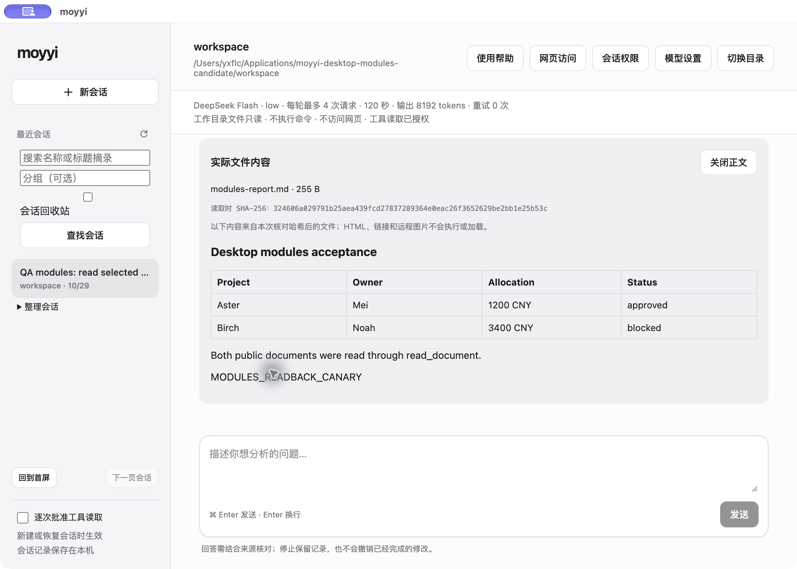
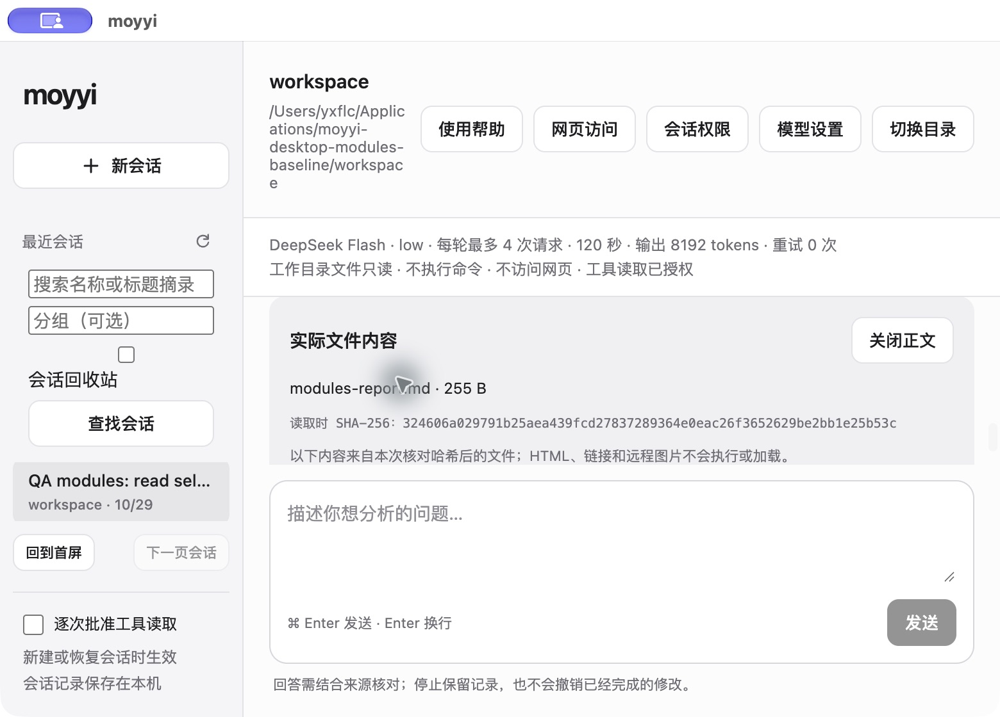
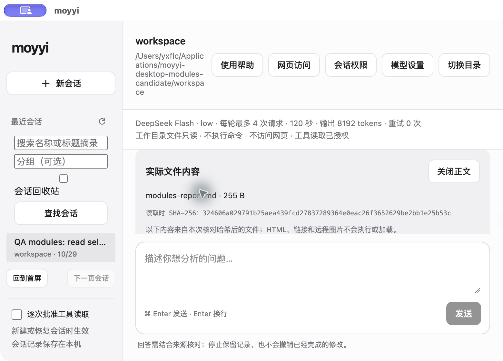
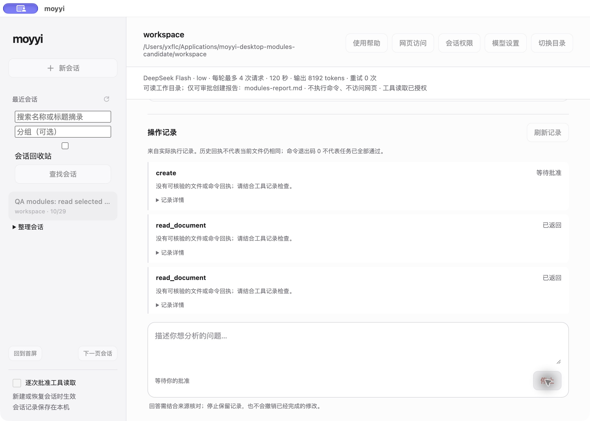
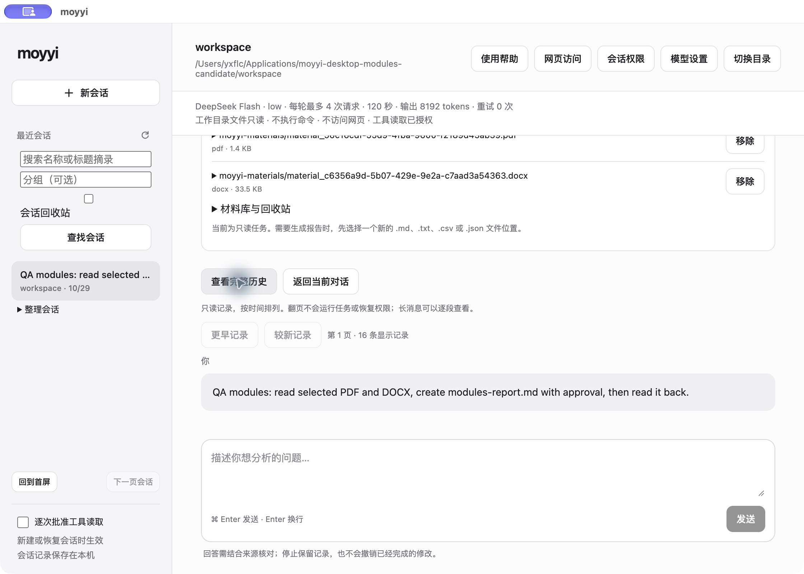

# Desktop modules native evidence

These captures contain only the repository's public Aster PDF, Birch DOCX and deterministic
acceptance task. Both runs used the actual packaged main, preload, renderer, host, parsers and
store. Only the disposable copies' worker was replaced with the committed offline fixture.
No daily installation was replaced. See the [delivery record](../../2026-10-29-desktop-modules-delivery.md)
and [machine-readable verification](verification.json).

Each variant completed native selection, actual parsing, exact report approval, readback,
preview, native save, menu quit, restart and history reopening. Each remained at four synthetic
requests, with zero network attempts or credential reads. The original inputs, saved copy and
report bytes were checked. The candidate's full history view showed 16 entries after restart.
All 235 protected daily app, settings and data files retained their original hashes.

| Native window | M6 baseline | Candidate |
| --- | --- | --- |
| 1120 x 800 points |  |  |
| 780 x 560 points |  |  |

Visual comparison found the same layout, controls, typography and report preview. Fixture paths,
cursor position and transient system overlays may differ. These are native captures at 2x pixel
density; they are not claimed to be pixel-identical screenshots. Separately, 13 renderer states
produced byte-identical baseline/candidate HTML and the packaged CSS bytes were identical.

The native minimum remains 780 px. Pointer resizing was unavailable in the automation surface,
so each disposable copy's initial window geometry alone was set to 780 x 560 for its narrow
capture. All other main bundle bytes, including the minimum, stayed unchanged. Original main
files were then restored and hash-checked. Source and delivered package were never changed.
The separate 560 px CSS diagnostic is outside the native window range and is not an accepted
native size.

Additional candidate evidence:

